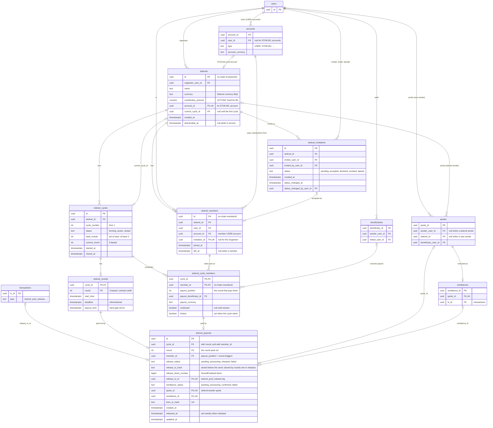

# Stokvel Database Model (Roles 2 and 3)

Section 3 of [stokvel_integration.md](stokvel_integration.md), kept in its own file. The ownership and change rule there apply here too, and changes are logged in [stokvel_changelog.md](stokvel_changelog.md).

> Write first (week-1 deadline). The most important section: backend, frontend and tests all depend on it. Draft; each table needs an ORM model imported in `models/orm/__init__.py`, an Alembic migration, and a row-level-security decision like the ledger tables.

### Tables

ER diagram of the built tables: [diagrams/stokvel_group_tables.svg](diagrams/stokvel_group_tables.svg) (source: the `.dbml` beside it).

The same tables and the existing tables they link to, from the ORM models. `users`, `accounts`, `beneficiaries`, `quotes`, `remittances` and `transactions` show only the columns involved in these links. `stokvel_contributions` (#228) and `stokvel_sync_state` (not yet built) are left out.

| Table | Key columns | Migration |
|---|---|---|
| `stokvels` | `id`, `organiser_user_id`, `name`, `currency` (Stokvel currency), `contribution_amount` (UCTUSD, fixed for the stokvel's life; the value sent to `createStokvel`), `created_at`, `deactivated_at` (null while in service), `account_id` (its `STOKVEL` ledger account, R3-01; nullable until the account is created, unique), `current_cycle_id` (its latest cycle, R2-05; null until the first) | `V20261009_1801__stokvel_group_tables`, `V20261011_1000__stokvel_ledger_account_and_types`, `V20261014_1200__stokvel_cycle_tables` |
| `stokvel_cycles` | `id`, `stokvel_id`, `cycle_number` (from 1; unique per stokvel), `status` (`forming`, `active`, `closed`), `total_rounds` (set at start, at least 2), `current_round` (0-based), `started_at` (null while forming), `closed_at` (set only when closed). At most one cycle per stokvel is not closed, as the contract allows one open cycle. `POST /stokvels` opens cycle 1 as `forming`, with no rounds yet (R2-09). When a cycle closes, the worker opens the next as `forming` in the same transaction (R2-15, `open_next_cycle`); for a cycle that closed before that, the Organiser's first setup or continuation call opens it. On-chain registration (R2-10): `start_tx_hash` (the `startCycle`, stored before it is sent; unique), `start_block_number` and `registered_at` (set once it is mined; contributions are refused until then). A `forming` cycle has none of them; `registered_at` may be set without a hash or block when the worker finds the cycle already open on-chain | `V20261014_1200__stokvel_cycle_tables`, `V20261019_1051__stokvel_cycle_chain_registration` |
| `stokvel_rounds` | PK (`cycle_id`, `round`); `round` is 0-based, the contract's `uint8 round`. `start_time`, `deadline` (informational), `payout_time` (hard gate, D12); CHECK start ≤ deadline ≤ payout. The cross-round order rule is checked when the cycle starts. Written by `POST /stokvels/{id}/cycles` (R2-10), one per member, to the whole second (the contract holds seconds) | `V20261014_1200__stokvel_cycle_tables` |
| `stokvel_members` | `id` (the on-chain `memberId`), `stokvel_id`, `user_id`, `account_id` (the member's account in the Stokvel currency that pays contributions), `invitation_id` (null for the Organiser), `joined_at`, `left_at` (null while a member). One active row per user per stokvel; rejoining makes a new row. `left_at` is set when the member leaves after a cycle, or, for a member of the closed cycle who never chose, when the Organiser starts the next (R2-15) | `V20261009_1801__stokvel_group_tables`, `V20261022_1000__stokvel_organiser_ends_membership` |
| `stokvel_cycle_members` | PK (`cycle_id`, `member_id`); `member_id` → `stokvel_members.id` (the on-chain `memberId`). `payout_position` (0-based: the round that pays them; unique per cycle; null until the order is set), `payout_beneficiary_id` (→ `beneficiaries`) and `payout_currency` (set together; the stokvel pays this beneficiary directly, #293), `continued` (on the closed cycle's row: true once the member continues, which the Organiser always does; false once they leave, or when the next cycle starts without their choice; null until then; R2-15), `locked` (set when the cycle starts; needs a position and a beneficiary). **The cycle's members are its locked rows** (R2-10): starting a cycle locks only the current members' rows, so a former member's row stays unlocked and counts for nothing. A row is added for the Organiser when the stokvel is created, and for each member who accepts while the cycle is `forming`; a member who joins during an active cycle gets an empty one when the next cycle opens (R2-15). From cycle 2, the members going into a forming cycle are those with a row in it: the Organiser (carried over with their beneficiary), each member who chose to continue, and each who joined since (`going_into`). A member who leaves keeps their row, and the next payout order clears its position (R2-09). Trigger `stokvel_cycle_member_same_stokvel`: the member row must belong to the cycle's stokvel (neither foreign key can check this) | `V20261014_1200__stokvel_cycle_tables` |
| `stokvel_invitations` | `id`, `stokvel_id`, `invitee_user_id`, `invited_by_user_id`, `status` (`pending`, `accepted`, `declined`, `revoked`, `lapsed`), `created_at`, `status_changed_at`, `status_changed_by_user_id`. Status changes once, so these two columns are its history; inviting again is a new row. One pending invitation per user per stokvel; only the invitee accepts or declines. Starting a cycle lapses every pending invitation to the stokvel, recorded as the Organiser's answer (R2-10) | `V20261009_1801__stokvel_group_tables`, `V20261019_1052__organiser_lapses_stokvel_invitations` |
| `stokvel_contributions` | `id`, `cycle_id`, `round` (0-based), `member_id` (→ `stokvel_members.id`, the on-chain `memberId`), `amount_token` (UCTUSD sent, the stokvel's `contribution_amount`), `amount_fiat` (debited from the member's Stokvel-currency account), `status` (`pending`, `processing`, `confirmed`, `failed`), `amount_zar` (the contribution plus its fee in rand, locked when it is made: what counts against the member's own limits, D8), `fiat_tx_id`, `token_tx_id`, `fee_tx_id` (→ `transactions`: the contribution's fiat, token and fee legs, each unique; `fee_tx_id` null when no fee applies; R2-11), `tx_id` (deprecated first name of `fiat_tx_id`: unused, kept for a later migration to drop, rule 5 in `api/alembic/README.md`), `evm_tx_hash` (unique; stored before the send, so a processing or failed row may have one), `block_number`, `created_at`, `confirmed_at` (set exactly when confirmed). A pending row has no hash or block; a confirmed row has both. Composite foreign keys: (`cycle_id`, `round`) → `stokvel_rounds` and (`cycle_id`, `member_id`) → `stokvel_cycle_members`, so the round and the member belong to the cycle. Partial unique index `uq_stokvel_contributions_once` on (`cycle_id`, `round`, `member_id`) where status is not `failed`: one live contribution per member per round, and a failed attempt can be retried as a new row | `V20261016_0901__stokvel_contributions`, `V20261016_1352__stokvel_contribution_legs_and_rand_value` |
| `stokvel_payouts` | `id`, `cycle_id`, `round` (0-based), `member_id`, `release_status`, `release_tx_hash` (stored before the send, so a processing or failed row may have one), `release_block_number`, `release_tx_id` (→ `transactions`, the `stokvel_pool_release` leg), `released_at`, `settle_queued_at` (when the event sync last queued its payout, R3-05), `remittance_status`, `quote_id`, `remittance_id`, `burn_tx_hash`, `created_at`, `updated_at`. UNIQUE (`cycle_id`, `round`); `release_tx_id`, `quote_id`, `remittance_id` and `burn_tx_hash` unique; `release_tx_hash` is not, since one `contribute` releases every round that has become due, so several rounds can share its hash (`V20261019_1700`). FK (`cycle_id`, `round`) → `stokvel_rounds` and (`cycle_id`, `member_id`) → `stokvel_cycle_members`. CHECKs: a pending row has no release hash or block; a block needs its hash; a released row has its hash, block and ledger leg, and `released_at` is set exactly when released; no remittance step, quote or remittance until released; a remittance needs its quote, a burn hash its remittance, and `confirmed` its burn hash. A failed release is retried on the same row. Trigger `stokvel_payout_member_is_scheduled`: the member's `payout_position` must be the round; its mirror `stokvel_cycle_member_position_is_paid` on `stokvel_cycle_members` refuses changing the position of a member a payout already pays | `V20261016_1200__stokvel_payouts`, `V20261019_1700__stokvel_payouts_release_hash_not_unique`, `V20261020_1700__stokvel_payouts_settle_queued_at` |
| `stokvel_sync_state` | **Built (R2-13, #235).** `id` (the contract address, lowercase: a redeploy starts its own cursor), `last_processed_block` (every event up to it is applied; ≥ 0), `updated_at`. Row-level security admits only sessions with no customer bound (the worker, migrations): no customer route can read or move it | `V20261018_1000__stokvel_sync_state` |
| `stokvel_held_events` | **Built (R2-13, #235).** Events the sync read but could not apply yet, so it moves past them without losing them: `contract_address`, `tx_hash`, `log_index` (unique together), `block_number`, `name` and `args` (bytes as 0x hex), or `raw_log` for a log that did not decode, `reason` (`waiting`: something it needs does not exist yet; `failed`: it raised, did not decode, or disagrees with the database, with `error`), `attempts`, `resolved_at`. Every run retries the unresolved rows first, in chain order. Worker-only row-level security | `V20261018_1000__stokvel_sync_state` |

Differences from the first sketch (a `stokvel` table plus a `stokvel_member` table):

- "Contributed this month or not" is **derived** from `stokvel_contributions`, not stored. A flag would go stale. A round is a contribution period set by the Organiser, not a calendar month.
- `number_of_members` is derived from members and capped by `MAX_STOKVEL_MEMBERS` (the contract's `maxMembers` is one value for every stokvel).
- A stokvel's state (draft or active) is derived from its cycles, not stored.
- Cycles, per-cycle payout order and the locked beneficiary need their own tables because membership and beneficiary can change between cycles but are fixed within one.
- `current_round` and `current_cycle_id` are kept as columns for cheap reads.
- Rounds and payout positions are 0-based, as in the contract (round *i* pays `memberIds[i]`), so they pass to `startCycle`, `contribute` and `finalise` unchanged. The frontend adds 1 for display.

### Row-level security

As for the ledger tables: `app.current_user_id` and `app.is_admin_route`, with `FORCE ROW LEVEL SECURITY`. Workers, migrations and admin routes see every row. A member means a current or former member. Product decided (2026-10-25) that a former member sees only activity up to `left_at`; these rules do not bound it yet, to be built with leaving a stokvel (#237, section 8).

| Table | A customer reads | A customer writes |
|---|---|---|
| `stokvels` | Stokvels they organise, are a member of, or hold a pending invitation to | As Organiser |
| `stokvel_members` | Their own rows and their fellow members' | Insert their own row only as the Organiser with no invitation, or with their accepted invitation to that stokvel (`stokvel_member_can_join`, R2-08); update their own row. The Organiser may also end a fellow member's membership: set a null `left_at`, and change nothing else (R2-15, `V20261022_1000`). No deletes |
| `stokvel_invitations` | Their own, plus every invitation of a stokvel they are a member of or hold a pending invitation to | Insert only as the Organiser, naming themselves as inviter, and only `pending`; update only to answer: the invitee accepts or declines, the Organiser revokes (R2-08) or lapses (R2-10, at a cycle's start), recorded as changed by the caller. No deletes |
| `stokvel_cycles` | Cycles of a stokvel they are a member of | As Organiser (insert and update only) |
| `stokvel_rounds` | Rounds of a stokvel they are a member of | As Organiser (insert and update only) |
| `stokvel_cycle_members` | Every row of a stokvel they are a member of | As Organiser, or their own row (beneficiary, continuation); insert and update only. Which columns each may change is checked by the controller |
| `stokvel_contributions` | Every contribution of a stokvel they are a member of | Insert only, for their own member row. No customer updates (the worker writes status, hash and block) and no deletes |
| `stokvel_payouts` | Payouts of a stokvel they are a member of | Never: only workers and admin routes insert and update (the release and settlement tasks, the admin fallback). No `DELETE` policy |

`stokvels` has one `FOR ALL` policy. `stokvel_members` and `stokvel_invitations` (since R2-08, `V20261017_1820`) the cycle tables and `stokvel_payouts` have one policy per operation instead: `FOR SELECT` with the read rule, and `FOR INSERT` and `FOR UPDATE` with the write rule. An `UPDATE` of a row the write rule does not allow matches no rows, rather than raising an error.

**Customers cannot delete cycle rows.** The cycle tables have no `DELETE` policy, so no one connected as `remitx_app` can delete from them, the Organiser included. Because the app always connects as `remitx_app`, that covers workers and admin routes too. A future task that needs deletes must add a `DELETE` policy for exactly who may delete, with a Postgres test. The reason: a single `FOR ALL` policy checks `DELETE` against its read rule only, so any member could delete what they can see. `stokvels` still works that way; a separate ticket is proposed to fix it. `stokvel_members` and `stokvel_invitations` have no `DELETE` policy either (R2-08).

**A membership's identity is fixed.** The trigger `stokvel_member_identity_fixed` refuses any update to `stokvel_id`, `user_id`, `invitation_id` or `joined_at`, and clearing a set `left_at`, for every role, with SQLSTATE 23514: leaving and rejoining makes a new row, so a former membership is never reopened. `invitation_id` is unique, so one accepted invitation admits once. Since R2-15 (`V20261022_1000`) it also refuses, for a customer updating someone else's row (only the Organiser's update policy reaches it), any change but setting a `left_at` that is still null: the paying account, and an ended membership, stay the member's own.

**An invitation's parties are fixed and its answer is final.** The member insert rule trusts an accepted invitation, so the invitation must be one the Organiser sent and the invitee accepted. Under R2-04's `FOR ALL` policy the invitee could write their own invitation: a customer could insert an `accepted` invitation to themselves for any stokvel and join with it, turn a declined invitation into an accepted one, move one to another stokvel, or delete it (reproduced on Postgres, #344 review). The trigger `stokvel_invitation_fixed` refuses any update to `stokvel_id`, `invitee_user_id`, `invited_by_user_id` or `created_at`, and any change to the status of an invitation that is no longer `pending`, for every role, with SQLSTATE 23514. A lapse, set by a worker, is final too. To try again, the Organiser sends a new invitation.

**Lookups that return a value, not rows (R2-08).** Row-level security hides two things the invitation routes need: the invitee's KYC applications from the Organiser, and the member rows from an invitee who has not joined. `kyc_latest_status(user)` returns the status of the user's latest application (the API decides from it, as `get_standing` does); `stokvel_active_member_count(stokvel)` returns the number of current members. Both are `SECURITY DEFINER`, executable only by `remitx_app`. A third, `stokvel_payout_name(stokvel)` (`V20261027_1847`), returns a stokvel's name to a customer it has paid (a quote with that `stokvel_id` names them as `beneficiary_user_id`), who is usually not a member; anyone else on a customer route gets NULL.

The policies look rows up through the functions `stokvel_is_member`, `stokvel_is_organiser` and `stokvel_has_pending_invitation` (R2-04), `stokvel_cycle_is_member`, `stokvel_cycle_is_organiser` and `stokvel_member_is_user` (R2-05), and `stokvel_member_can_join` (R2-08), because a policy that queries its own table (or two that query each other) fails with infinite recursion. Inside a function `app.current_user_id` is empty, so its own lookup sees every row. SQLite (tests) has no RLS, so repositories must still filter by user. Tests: `api/tests/test_stokvel_group_models.py`, `api/tests/test_stokvel_cycle_models.py` `api/tests/test_stokvel_member_row_security.py` and `api/tests/test_stokvel_payout_model.py` (`postgres` lane).

### Ledger changes

| Change | Detail |
|---|---|
| New account type | **Built (R3-01).** One `STOKVEL` account per stokvel, in the token, linked from `stokvels.account_id`. See "Stokvel account" below. |
| New transaction types | **Built (R3-01).** `stokvel_contribution` and `stokvel_pool_release`. **Ledger model (agreed 2026-10-16, R2-11):** a contribution is member fiat account → RemitX bank (fiat leg) and Treasury Wallet → `STOKVEL` account (token leg; on-chain the Treasury pays the contract), plus a `fee` leg (member → fee revenue) when a fee share applies. A pool release is `STOKVEL` account → Treasury Wallet (on-chain the contract pays the Treasury). So the `STOKVEL` balance always equals the stokvel's unreleased pools in the contract, and a pool is never counted twice. The payout (R3-05) is then paid from the Treasury Wallet, where the release has already put the pool: Treasury → beneficiary token → Treasury → burn, not back through `STOKVEL` (decided 2026-10-19, #241). The stokvel is the quote's sender (`quotes.stokvel_id`), and every payout leg carries that quote's `quote_id`. No `stokvel_refund`: refunds are not in v1 (#208). |
| Payout legs | **Built (R3-05, #242).** Reuse the existing leg types grouped by `quote_id`, with the stokvel as the quote's sender and the first token leg from the Treasury Wallet (see above), so the proven settlement worker and its idempotency are reused. `stokvel.settle_payout` creates four, all `pending`: `remittance` Treasury Wallet → beneficiary token account (the remittance's `tx_id`), `remittance` beneficiary token account → Treasury Wallet, `token_burn` Treasury Wallet → token issuer (each the pool in UCTUSD), and `beneficiary_payout` RemitX bank → beneficiary fiat account (`receiver_amount` in the payout currency). No `fee` leg and no fiat cash-in leg: the members paid the fee with their contributions (D6), and no fiat comes in. No separate `STOKVEL_REMITTANCE` type (resolved in section 8 of [stokvel_integration.md](stokvel_integration.md#8-open-questions)). |
| Quote sender | **Built (R3-02).** A quote is sent by a user or by a stokvel, never both. See "Stokvel as quote sender" below. |
| EVM names | **Built (R3-02).** `xrpl_tx_hash` becomes `evm_tx_hash`, and the treasury account becomes `REMITX_EVM_WALLET`. See "EVM names" below. |
| Limits | Contributions count toward the member's limits: extend `RemittanceRepository.sent_zar` (or add a parallel sum) so contributions are included. |
| Pool reconciliation | **Built (R3-08, #245).** `check_pool_reconciliation(on_chain)` compares that UCTUSD balance with the Treasury account's confirmed token legs (in minus out). `contract_held` is the sum of `STOKVEL` balances: tokens in the contract, not in the wallet. `in_flight` is the same net over `processing` legs that already have an `evm_tx_hash`, printed by the demo command and not added into the float: the hash is stored before the send (#278), so it is not proof the chain moved. A mined burn still `processing` (`burn_unconfirmed`) therefore FAILs, and the command says the gap is that net. Pending and failed legs are excluded. Run `python scripts/check_pool_reconciliation.py` from `api/`. One `token_burn` per quote: partial unique index `uq_transactions_one_token_burn_per_quote`. `transactions` has no round; one payout per round already has one quote. A failed burn stays on that row; another attempt is a new quote (section 8). Every confirmed UCTUSD leg counts, including a rate-difference leg. None is booked: the contribution is fixed UCTUSD (D13) and #298 is closed. |

#### Stokvel account (R3-01)

- Created by `AccountRepository.create_stokvel_account`, with the label `Stokvel <id>`. `POST /stokvels` (R2-07) calls it in the same transaction as the stokvel, so every stokvel created through the API has one; `account_id` stays nullable for rows made before.
- Its balance can never go below zero (CHECK `accounts_stokvel_balance_nonneg`).
- `accounts_type_valid` now allows `STOKVEL`. The owner and reference CHECKs needed no change: only `USER` accounts must have a user and a reference.
- It is not a platform account, so `list_platform_accounts` leaves it out.
- Why a stokvel has its own account: ADR 0004.

#### Stokvel as quote sender (R3-02)

- `quotes.sender_user_id` is now nullable, and the new `quotes.stokvel_id` names a stokvel sender. CHECK `quotes_one_sender` requires exactly one of the two.
- Stokvel quotes skip `require_can_send` (D8). **Built (R3-05, #242):** `settle_payout` never calls it, and `price_stokvel_payout` applies no limits. The quote is created already `USED` (there is no customer to accept it), with `sender_amount` the pool at the live rate in the Stokvel currency, `token_amount` exactly the released pool (so the burn matches the release), and no fee or margin. `receiver_payout_fee` and `receiver_payout_estimate` are filled as for a user's quote; the `beneficiary_payout` leg credits the full `receiver_amount`.
- **Members:** row-level security on `quotes` matches on `sender_user_id`, so customers cannot see a stokvel's quote. Members see their stokvel's payouts through `stokvel_payouts` instead, in `GET /stokvels/{id}` (R2-14, #236), so the `quotes` and `remittances` policies are unchanged (section 8 of [stokvel_integration.md](stokvel_integration.md#8-open-questions)).
- **Recipient:** still sees the payout. The transfer reads (`RemittanceRepository._records`, `OverviewRepository._facts`) outer-join the sender user, so the payout shows in the recipient's transfer list, transfer page and dashboard, and in the admin totals. For such a payout, `TransferRead.counterparty_user_id` and `counterparty_name` are null.

#### EVM names (R3-02)

- `transactions.xrpl_tx_hash` becomes `evm_tx_hash` in two steps (rule 5 in `api/alembic/README.md`):
  1. **Now:** `evm_tx_hash` is added and backfilled. The worker writes both columns; code reads only `evm_tx_hash`.
  2. **Later:** a migration drops `xrpl_tx_hash` (open question in section 8 of [stokvel_integration.md](stokvel_integration.md#8-open-questions)).
- API fields are now `evm_tx_hash` and `burn_evm_tx_hash`.
- Treasury account type `REMITX_XRPL_WALLET` becomes `REMITX_EVM_WALLET`, and its seeded label "RemitX XRPL Treasury Wallet" becomes "RemitX Treasury Wallet". `remittance_service.py` imports the label from the seed, so the two cannot drift apart.

### Status values and transitions

| Entity | Transitions |
|---|---|
| Contribution | `pending → processing → confirmed \| failed` |
| Pool release | `pending → processing → released \| failed` |
| Remittance | `pending → processing → confirmed \| failed` (the existing transaction states; `created`, `burning`, `burnt` and `credited` are not separate states). Stored on the payout as `stokvel_payouts.remittance_status`, not read through `remittance_id`, so a failure before any remittance exists is still recorded. **Built (R3-05, #242):** `settle_payout` moves it `pending → processing` in the same commit that creates the quote, legs and remittance and sets `quote_id` and `remittance_id`, or `pending → failed` with nothing created when the beneficiary no longer fits. **Built (R3-06, #243):** `confirm_treasury_burn` moves it `processing → confirmed` with `burn_tx_hash`, or `processing → failed`, in the commit that confirms or fails the legs (`stokvel_payouts.record_settlement`). A burn with no receipt after the retries leaves it `processing` for a person, as it leaves the legs |
| Invitation | `pending → accepted \| declined \| revoked \| lapsed` |
| Cycle | `forming → active → closed` |

_The brief's wording of the remittance statuses (`created → burning → burnt → credited`) differs from the existing ledger states. Resolved (product, 2026-10-25): keep the ledger states, because the ledger already uses them and switching to the brief's names would need several changes. Listed under Deviations from the brief._

### Where on-chain values are stored

| Value | Column |
|---|---|
| Contribution transaction hash | `stokvel_contributions.evm_tx_hash` |
| Pool release hash | `stokvel_payouts.release_tx_hash` |
| Burn hash | `transactions.evm_tx_hash` (on the `token_burn` leg) and `stokvel_payouts.burn_tx_hash`. The worker writes it after signing and before sending (#278), so a hash on a `processing` or `failed` leg is not proof of a burn: only a `confirmed` leg's hash is, and readers show it only then. `xrpl_tx_hash` is still written alongside while the rename is in its expand phase (#239). `stokvel_payouts.burn_tx_hash` is written only once the burn is confirmed, in the same commit as the legs (R3-06, #243), so a failed payout has none |
| Remittance reference | `stokvel_payouts.remittance_id` (→ `remittances`) |
| Block number | `stokvel_contributions.block_number` |

### Idempotency rules

| Step | What stops it running twice |
|---|---|
| Submit contribution | Partial unique index `uq_stokvel_contributions_once` on (`cycle_id`, `round`, `member_id`) over rows not `failed`; guarded `pending → processing` claim in the worker; contract `AlreadyPaid` |
| Release pool | UNIQUE (`cycle_id`, `round`) on `stokvel_payouts`; guarded `pending → processing` claim before `finalise`; `record_pool_release`'s guarded move to `released`, the only writer of a release, which alone books the leg; contract `AlreadyFinalised` |
| Create payout remittance | Guarded `pending → processing` update on `stokvel_payouts.remittance_status` (only once `released`, and only while `quote_id` is null), in the same commit as the quote, legs and remittance: a delivery whose update matches nothing rolls them all back (R3-05, #242); UNIQUE `quote_id` and `remittance_id` on `stokvel_payouts` |
| Record a burn | Partial unique index `uq_transactions_one_token_burn_per_quote` on `transactions.quote_id` where `type = 'token_burn'` (R3-08, #245). A quote's other legs are not unique on `quote_id`. One payout has one quote, so that round's current burn is that one row. A failed burn stays on its quote; another attempt is a new quote (section 8) and may have its own burn. A burn with no `quote_id` is not covered: NULL is distinct in a unique index, and a CHECK would reject burns recorded before this index |
| Credit remittance | Existing guarded group-confirm on `quote_id` (`confirm_treasury_burn`); a retry must not repeat the release, burn or credit. The burn: only the delivery that claims the group `pending → processing` sends it, and a later delivery waits on the stored burn hash instead of sending another (#278). A payout's hand-off (`settle_payout`) and the reclaim sweep may both queue `settle_remittance` for it; `settle_remittance` queues the burn only while the burn leg is pending, and the claim lets one delivery send. The payout row is finished in the group-confirm's commit, guarded on `processing` (R3-06, #243) |
| Refund | Guarded status transition on the contribution; contract refund-once flag |
