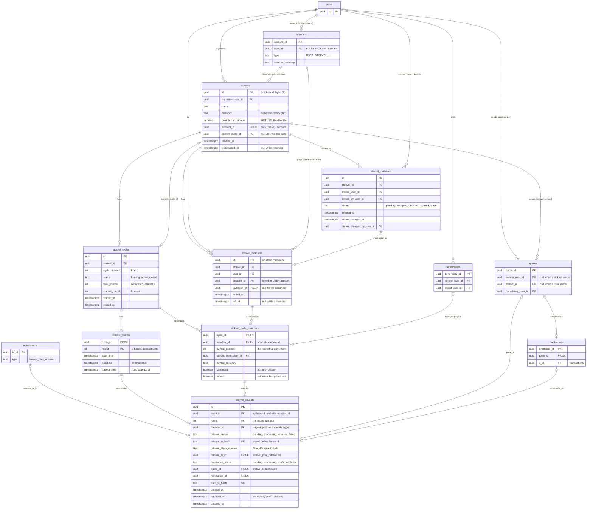

# Stokvel Integration

This file keeps track of the process of implementing the Stokvel integration into the RemitX platform: the features added, how the pieces are connected, the user flow, and the files and functions created along the way. It is the shared contract between the six roles: everything one person builds that another person's code depends on. If someone's Claude session needs a function name, a status value or an API shape, it should come from here, not be invented.

Terminology follows [CONTEXT.md](../CONTEXT.md). Architectural decisions are recorded in [docs/adr/](adr/). The class brief is [ftc_project_brief.md](ftc_project_brief.md).

## Ownership and change rule

| Section | Owner |
|---|---|
| 1. Contract interface | Role 1 |
| 2. Network and addresses | Role 1 |
| 3. Database model | Roles 2 and 3 |
| 4. Worker tasks | Roles 2 and 3 |
| 5. REST API | Roles 2, 3 and 4 |
| 6. Error mapping | Roles 1, 2 and 4 |
| 7. TrustMeBank touchpoints | Role 5 |
| 8. Open questions | All |
| 9–14. Progress, features, flow, files, functions | Whoever makes the change |
| Decisions, Proposals, Deviations, EVM switch-over | All (changes via PR) |

**Change rule:** any change to an interface in this file goes through a PR approved by the owners it affects. No one changes an interface quietly inside a feature PR.

## Changelog

| Date | Section | Change | PR |
|---|---|---|---|
| 2026-10-05 | all | File created with section skeleton | |
| 2026-10-06 | all | Added Decisions, Proposals, Deviations, EVM switch-over, work breakdown; drafted sections 1–8 and 11–12 from CONTEXT.md, GitHub issues #197–#209 and earlier design sessions | |
| 2026-10-07 | Proposals, Deviations, 1, 5, 6 | Added P5: manual admin finalise as a fallback to automatic finalisation (route `POST /admin/stokvels/{id}/rounds/{n}/finalise`) | |
| 2026-10-19 | Proposals, 8, 13 | Admin manual release (R4-11 #260) on mocks until R3-10 (#247): an admin Stokvels → Rounds page lists each stokvel's current round (recipient, paid, payout time, status: waiting, release in progress, release failed, released) with a Release payout button that asks first and shows section 6's "This round can't be paid out yet." or "This round has already been paid out." when refused. Product approved P5 (Q5, Sian, 19 Oct). Assumes `POST /admin/stokvels/{id}/rounds/{n}/finalise`; no admin route lists stokvels and rounds yet, to agree with Role 3 (#247) | #260 |
| 2026-10-07 | 3, 8, 9 | Synced with the product deviations file: recommend keeping the ledger status names; contribution amount, fees (with the fee-to-fiat suggestion), deadline, limits and key storage listed as product confirmations; Treasury Wallet created | |
| 2026-10-07 | Decisions, 8 | D1 records lecturer approval of the EVM move (Marc). Added open question: are the fee and margin converted back to fiat | |
| 2026-10-07 | 9 | GitHub issues recreated from the ticket plan: #199–#206 and #209 closed and replaced (#217, #216, #273–#278, #229); #207 and #208 kept; mapping in the ticket plan ("GitHub issues") | |
| 2026-10-07 | 7, 9, Deviations | TrustMeBank deposits and withdrawals (#202, #203) are now required, not optional | |
| 2026-10-07 | 3, 4, 5, 8, 9 | Review fixes: P2 now mentions the payout time; P5 listed before P6; `stokvel_sync_state` added to section 3; pause and cancel take a `reason`; section 9 records PR #211 (#205 and part of #204); added an open question on log redaction hiding transaction hashes | |
| 2026-10-07 | 5, 8, 9 | Added the stokvel audit log of admin actions (section 5): new audit actions and subjects on the existing `audit_log`, viewed through `GET /admin/audit` | |
| 2026-10-19 | 5, 13 | Admin audit page stokvel view (R4-12 #261): an Area filter (`subject_type=stokvel` or `stokvel_contract`, one per request, so each view writes one `audit.log.viewed`), the three stokvel admin actions in the action filter, and an explorer link for any EVM transaction hash an entry records. No backend change: `GET /admin/audit` already filters by `subject_type`, so the suggested `action_prefix` isn't needed | #261 |
| 2026-10-07 | Decisions, Proposals, 1, 3, 4, 8, 11, 12 | D5 amended and D12 added: a round is released only when it is fully paid **and** its payout time has passed (Organiser-set); a scheduled backend task releases due rounds. Deadline stays informational. Added P6 (merge deadline and payout time) | |
| 2026-10-08 | 1, 2, 6, 9, 13, 14 | Section 1 confirmed against the contract as built (DEC-1 #212, R1-01 #215): constructor and deployment arguments, final signatures, `cycle` added to `ContributionMade` and `RoundFinalised`, error `CycleClosed` renamed `CycleNotOpen` (name clash with the event), input-validation errors, view signatures, member IDs are per-stokvel row UUIDs. Cancel and refund marked planned (#220). Section 2: deployer and Treasury Wallet addresses. Section 6: error rename. Sections 9, 13, 14: contract progress, files and functions | |
| 2026-10-08 | 1, 6 | Treasury allowance agreed with the backend: one-off `approve(vault, max)` per contract address, checked before each `contribute` and re-approved if low. Section 6 maps the token's `ERC20InsufficientAllowance` to a backend 500. Backend confirmed sections 1 and 6, and the fixed contribution amount in `createStokvel` | |
| 2026-10-09 | 1 | MVP decision: the contribution amount is fixed per stokvel for all cycles; a new amount means a new stokvel | |
| 2026-10-15 | 9, 13 | Frontend scaffold (R4-02 #251): `app/stokvels`, `app/stokvels/:stokvelId` and `admin/stokvel-contract` routes, sidebar entries, and mocked responses shaped like §3 and §5 behind `lib/stokvels.ts`. The R4-01 screen list (13 screens) is on #250 | #251 |
| 2026-10-19 | 8, 13 | Create wizard (R4-03 #252), matched to R2-07 as built: name → amount → review, sending exactly `{ name, currency, contribution_amount }` with the generated client. The Organiser types the amount in the Stokvel currency; the wizard converts it to UCTUSD at the quote preview's live rate, rounded to the cent (section 8). The preview shows each member's fee share paid on top and the full pool reaching the beneficiary (D6). Member count and schedule are not chosen at creation (section 8, round schedule). The list reads `GET /stokvels` | #252 |
| 2026-10-16 | 8 | Product answers to Karabo's screen questions (via Sian): the payout goes to the member's chosen beneficiary (as #293); invite by RemitX account reference, with no WhatsApp share button before the MVP; wizard hint "Your account is charged at the live rate at the moment you pay."; keep the sidebar (no bottom tabs). Fees on top is recorded in D6 (#340) | |
| 2026-10-19 | 6, 13 | Stokvel page and contribute flow (R4-05 #254): pot ring, Pay now → confirm sheet → confirming → paid, the current round's payout tracker, payout order, members and round history. Pay now calls `POST /stokvels/{id}/contributions` (#233); the detail read stays mocked until #236. Fees on top (D6): the sheet shows an estimated fee share before paying (the quote preview on the pool, split and rounded up like `contribution_fee_share`) and the API's `fee_amount` after; the low-balance check covers both. Codes are read from `ErrorResponse.code`, including #232's `cycle_starting` (retryable). A hash is shown as proof only once its contribution is confirmed or its release is `released` (section 3); a failed release shows as failed, without promising a retry | #254 |
| 2026-10-09 | 2, 8, 9, 10, 13, 14 | Contract work brought up to date: section 2 lists the deploy script's settings and `DEPLOYER_PRIVATE_KEY` (local only); section 8 resolves the contract side of the contribution amount and the Treasury allowance, defers per-cycle amounts, and adds the admin-key question for pause (#244); section 9 marks the contract, tests and pause done (PR #282 merged), deployment in progress (#284) and README/ABI/ADR in review (#285); sections 10, 13 and 14 list the contract features, files and scripts | |
| 2026-10-09 | 1 | Error precedence: `AlreadyPaid` is checked before `WrongRound` (a repeat payment always reports `AlreadyPaid`), and a round beyond the last is rejected (fix in branch `fix/duplicate-contribution-error`) | |
| 2026-10-09 | 9, 13 | Contract tests: randomised invariant tests added (fix branch); 73 tests once the open PRs merge | |
| 2026-10-09 | 1, 2, 6, 8, 9, 10, 13, 14 | Review fixes on #283: error order marked *pending #291* (on main a repeat payment into a filled round still reports `WrongRound`, and a nonexistent round is accepted); files and features from #284, #285 and the fix branch marked "not on main yet"; ID scheme added as an open question (Katlego's review) and flagged in section 1; `CycleNotOpen` maps to neutral `cycle_not_open`; `ERC20InsufficientBalance` mapped (Treasury out of UCTUSD); UCTUSD checked on testnet: re-approve from non-zero is fine, and `burn(uint256)` works from the Treasury (answers the burn-method question, to confirm on #278) | |
| 2026-10-09 | 1, 9, 13 | #291 merged: section 1 error order is now what `main` does (pending markers removed); tests 71 on `main` | |
| 2026-10-09 | 2, 9, 13 | Contract deployed: `StokvelVault` at `0x2f240705314BB79780522635eA47d20072CB8Fe1` (block 8995825), verified on Sourcify; deployment record and `STOKVEL_CONTRACT_ADDRESS` in PR #284; smoke test from the Treasury pending | |
| 2026-10-19 | 5, 13 | Admin pause and resume (R4-07 #256) on mocks until R3-07 (#244): the contract card shows Running or Paused (since when, and why), Pause asks for a reason (10 to 500 characters, for the audit log) and says what stops, Resume asks to confirm. Assumes `POST /admin/stokvel-contract/pause` with `{ reason }`, `POST /admin/stokvel-contract/unpause`, and `paused_at` and `paused_reason` on the contract read. Notes for #244 from the contract review (Kerry): the contract's `Paused` / `Unpaused` events carry no time or reason, so `paused_at` and `paused_reason` must come from the backend's own record (the audit log, #249); and until the API refuses contributions with 503 `stokvel_paused` while paused (OI-4), a member can still submit one, which the worker (#234) retries and then fails. Resuming releases nothing by itself: a due round goes out with the next contribution or the scheduled release (#248) | #256 |
| 2026-10-09 | 2 | `DEPLOYER_PRIVATE_KEY`: listed in `.env.example` as a commented, empty placeholder (#284); the value stays in the deployer's local `.env` | |
| 2026-10-09 | 2 | Deployer key moved to `contracts/.env` so docker compose does not load it into the API and worker containers (#284) | |
| 2026-10-09 | 1, 8 | Backend review (Role 2): section 1 notes that UCTUSD's `ERC20InsufficientAllowance` / `ERC20InsufficientBalance` are not in the vault ABI (selectors given; decode with OpenZeppelin's ERC20 errors); ID scheme: backend agrees on packed UUID for the MVP, pending Marc | |
| 2026-10-09 | 2, 9, 10, 13, 14 | #283 and #284 merged; with #285, the README, ABI and ADR land too, so the "not on main yet" markers are removed and the contract rows are Done (deployment: smoke test pending) | |
| 2026-10-09 | 2 | Deploy script (Claire's #285 review): records the address before the post-deploy checks; blank settings fall back to defaults; `FORCE_REDEPLOY` documented | |
| 2026-10-09 | Proposals, 3, 5, 8, 9, 13, 14 | R2-04 (#226): `stokvels`, `stokvel_members` and `stokvel_invitations` built with row-level security (section 3). Product: fixed fiat contribution for the stokvel's life; cancellation, refunds and disputes not in v1 (P4); members and invitees see a stokvel's invitations; former members keep their history. Dropped `max_members` and `stokvels.status`; `current_cycle_id` moves to R2-05, `account_id` to R3-01; invitations can be revoked. New tickets: #297 (revoke route), #298 (rate difference), #299 (invitations screen) | #300 |
| 2026-10-11 | Decisions, 3, 8, 11 | Product: contribution amount is **fixed token** (UCTUSD), not fixed fiat. `stokvels.contribution_amount` is that UCTUSD amount; member fiat debit = amount × live rate at contribution. D13. Closes #298 (rate-difference booking was only needed under fixed fiat) | #300 |
| 2026-10-11 | 3, 8, 9, 13, 14, EVM switch-over | R3-01 (#238) and R3-02 (#239) built. Each stokvel gets a `STOKVEL` ledger account; new transaction types `stokvel_contribution` and `stokvel_pool_release` (no `stokvel_refund`: refunds are not in v1); a quote's sender can be a stokvel; `xrpl_tx_hash` becomes `evm_tx_hash` (not `onchain_tx_hash` as first planned) and the treasury becomes `REMITX_EVM_WALLET`. Details in section 3, "Ledger changes"; ADR 0004. Two follow-ups added to section 8 | #301 |
| 2026-10-12 | 3, 14 | `stokvels.deactivated_at` (null while in service). Membership `account_id` must be the member's fiat account in the stokvel currency | #300 |
| 2026-10-13 | 3, 14 | Made stokvel RLS helper and validation functions Neon-compatible: hardened `SECURITY DEFINER` functions replace unsupported custom-GUC function settings while preserving recursive-policy avoidance; PostgreSQL regression coverage added | |
| 2026-10-13 | 3, 8, 13 | Fix: a payout from a stokvel no longer goes missing from the recipient's transfers, transfer page and dashboard, or from the admin totals (the reads used to drop any quote without a sender user). Section 8: proposal for how members see their stokvel's payouts (pending roles 2 and 3), and two new questions: what former members see, and what sender name the recipient sees | #301 |
| 2026-10-14 | Decisions, 8, 11 | Fee timing is now an open product question: from the pool at payout, or on top of each contribution (product question 4 in `docs/stokvel-product-questions.md`). D6 and section 11 call "from the pool" the current plan, not a decision. Blocks R3-05 (#242) | #301 |
| 2026-10-14 | 11 | `Transaction_Flow_Context.md` is frozen as the original RemitX project's record, so it is no longer on the EVM switch-over list. Notice added to it and to CLAUDE.md | #301 |
| 2026-10-14 | 3, 8, 9, 13, 14 | R2-05 (#227): `stokvel_cycles`, `stokvel_rounds` and `stokvel_cycle_members` built with row-level security, plus `stokvels.current_cycle_id`. Rounds and payout positions are 0-based like the contract. No `token_contribution_amount` on cycles (the amount is `stokvels.contribution_amount`, D13). #293 decided: the stokvel pays the member's chosen beneficiary directly, so `payout_beneficiary_id` and `payout_currency` are firm | |
| 2026-10-14 | Decisions, 5, 12 | D3: the members agree the payout order off the platform; the Organiser only enters it. The platform does not assign the order (no automatic ordering, e.g. by acceptance time). CONTEXT.md "Payout order" updated to match | |
| 2026-10-14 | 14 | Renamed the cycle repository reads to `get_open_cycle`, `get_cycle_rounds`, `get_cycle_members` | |
| 2026-10-14 | Decisions, 9, EVM switch-over | D11 now covers code too: XRPL files, scripts and the `xrpl-py` package are kept and marked as no longer used, the same as the XRPL settings already were. Only change what EVM needs, so we can switch back to XRPL easily. D1 and the switch-over rows for `xrpl_service.py`, the wallet script and `pyproject.toml` now say "keep" instead of "replace" | #301 |
| 2026-10-14 | 3, 9, 13, 14 | #278: settlement burns UCTUSD on the XRPL EVM chain with `burn(uint256)` from the Treasury (`evm_service.burn_tokens`), exactly the `token_burn` leg's amount. The burn hash is now stored before the send, so only a `confirmed` leg's hash proves a burn (section 3); a retry waits on the stored hash and never sends a second burn. Every Treasury send goes through `submit_transaction`, which holds `treasury_send_lock`. The burn method is still to be confirmed by a test burn (section 8) | |
| 2026-10-19 | 13, EVM switch-over | R4-08 (#257): one chain-neutral `ChainTxHash` replaces the XRPL-only `TxHash` and `XrplHash` on the transfer, account-history and stuck-settlements pages. `lib/chain.ts` picks the explorer from the hash: `0x…` goes to the XRPL EVM Testnet explorer (`VITE_EVM_EXPLORER_URL`, defaulting to `EVM_EXPLORER_URL`'s value), anything else to testnet.xrpl.org, so older XRPL transfers keep working links and a switch back needs no change (D11). The section 6 code-to-message map is in `lib/stokvel-errors.ts` (#254) | #257 |
| 2026-10-14 | 8, 9 | Burn method confirmed: a 1-base-unit `burn(uint256)` from the Treasury, tx [`0xacfd…9cd6`](https://explorer.testnet.xrplevm.org/tx/0xacfd84b642ff7d30b535bf8256fc572657d54894a444e13039c212d4d68f9cd6) (block 9072949), lowered `totalSupply` from 99999990000000000000000000 to 99999989999999999999999999 base units. The section 8 question is closed | |
| 2026-10-15 | 3, 13, 14 | R2-05 (#227) hardening. The cycle tables' row-level security is now one policy per operation (`SELECT` with the read rule; `INSERT` and `UPDATE` with the write rule) and has no `DELETE` policy: a Postgres probe showed the single `FOR ALL` policy let any member delete cycles, rounds and other members' cycle rows. New trigger `stokvel_cycle_member_same_stokvel` refuses a cycle member from a different stokvel. The group tables (#226) have the same delete gap; a separate ticket is proposed | |
| 2026-10-15 | 8, 9, EVM switch-over | R6-02 (#267), on top of #278: the seeder's `verify --chain` compares the ledger treasury with the Treasury Wallet's UCTUSD balance (`evm_service.get_token_balance(EVM_TREASURY_ADDRESS)`) instead of XRPL trust lines; the seeder isolates the `EVM_TREASURY_*` / `EVM_ENCRYPTION_KEY` settings per target; simulated burn failures read as EVM errors. Load test: `fake_xrpl_worker.py` renamed `fake_evm_worker.py`, `qa_xrpl_timings.sql` renamed `qa_burn_timings.sql` and now measures only EVM burns (hashes starting `0x`), report labels say UCTUSD. Burn timing defaults are still the XRPL figures until QA has real EVM burns | |
| 2026-10-16 | 3, 8, 9, 13, 14 | R2-06 (#228): `stokvel_contributions` built with row-level security. **Changed from the planned UNIQUE (`cycle_id`, `round`, `member_id`)** to a partial unique index over rows that have not failed, so a member can pay again after a failed attempt (otherwise a failed send would block the round for good); needs Roles 2 and 3 approval. Composite foreign keys keep the round and member inside the cycle. Added `created_at` (for limit windows) and `confirmed_at`. New open question: which ledger leg `tx_id` names (R2-11) | |
| 2026-10-16 | 3, 5, 8, 9, 10, 13, 14 | R2-07 (#229): `POST /stokvels` and `GET /stokvels` built (section 5). Creating a stokvel is one transaction: the stokvel, its `STOKVEL` ledger account and the Organiser's membership (their own fiat account in the Stokvel currency, `invitation_id` null). `contribution_amount` is UCTUSD (D13); the ticket comment's "fiat" predates D13. A caller who is not KYC-verified gets 403, one with no account in the Stokvel currency gets 400. The list leaves out stokvels the caller has left and answered invitations, and scopes by user in the query as well as by row-level security. New open questions: where the round schedule is set, list fields that need the cycle and contribution tables, and members inserting their own membership (section 8). Interface change: needs Roles 3 and 4 approval | |
| 2026-10-16 | 3, 5, 6, 8, 9, 13, 14 | R2-11 (#233): `POST /stokvels/{id}/contributions` built. Ledger model agreed with Role 3: contribution = member fiat → bank + Treasury → `STOKVEL` (+ fee leg); pool release = `STOKVEL` → Treasury, so the `STOKVEL` balance equals the unreleased pools in the contract. `stokvel_contributions` gains `fiat_tx_id`, `token_tx_id`, `fee_tx_id` and `amount_zar` (contribution + fee in rand, counted in the member's limits, D8); `tx_id` deprecated. The `transactions` policy now lets members see and record legs on their stokvel's `STOKVEL` account (needs Roles 2 and 3 approval). Stokvel refusals carry a `code` in the error body. Fee rule: next row | |
| 2026-10-16 | Decisions, 3, 5, 6, 8, 11, 14 | Product question 4 answered **A, fee on top** (confirmed by Kerry with product). D6 amended: each member pays an equal share of the round's payout fee (FSE's fixed + percentage fee and, when the recipient is paid in another currency, the FX margin, all on the pool) on top of their contribution, rounded up to the cent; the beneficiary receives the full pool. `contribution_fee_share` implements it and R2-11 records the `fee` leg. The fee-to-fiat question is resolved (the fee is collected in fiat). R3-05 (#242) must not charge the payout's fee again. Sections 5, 6 and 14 now also list the response, the API-only refusals (404, short balance, unverified, over limit), the new error classes, `DomainError.code` and the `get_standing` change | #233 |
| 2026-10-16 | Decisions, 6, 8, 13, 14 | R2-11 review (Claire, #340). The `transactions` change is now two separate policies beside an unchanged `transactions_by_current_user`: `transactions_stokvel_member_select` (read legs on the `STOKVEL` account of a stokvel you are or were a member of) and `transactions_stokvel_member_insert` (record a leg into it while a current member, `stokvel_account_is_active_member`). No update or delete policy, so no member's session can change or remove a stokvel leg. A non-member now gets 404 (as row-level security already gave on Postgres), not 403. Only `uq_stokvel_contributions_once` answers "already paid"; other integrity errors are raised. The fee is priced on the round recipient's locked payout currency. D6 notes the rate drift between shares; R3-05 must not reconcile against it | #340 |
| 2026-10-16 | 5, 6, 8, 9, 11, 14 | R2-11 second review (#340). A contribution looks its rates up before locking the member (`quote_service.token_rates`): a lookup may fetch a live rate and commit, which released the lock. The fiat debit multiplies by the stored USD quote, not a rounded inverse. A lost enqueue is logged loudly, as in `confirm_remittance`. No exchange rate answers 503. `ErrorResponse` in the OpenAPI spec gains an optional `code`. The insert policy now pins both sides: a `stokvel_contribution` leg from the Treasury Wallet (`account_is_treasury_wallet`) into the member's stokvel's account. Section 11 corrected to the agreed release direction (`STOKVEL` → Treasury); R3-03 (#342) and R3-04 to match | #340 |
| 2026-10-17 | 4, 6, 8, 9, 13, 14 | R2-12 (#234): `stokvel.submit_contribution` and `stokvel.confirm_contribution` built in `remitx_worker/stokvel_tasks.py`, over a new contract wrapper `remitx_worker/stokvel_contract.py` (`contribute`, the Treasury allowance check, revert decoding against the vault and `IERC20Errors`). Task names stay `stokvel.<name>` (section 4), the convention for every stokvel task. `confirm_contribution` also takes the receipt's `block_number` (a confirmed row needs it). Platform-side refusals (paused, Treasury short of UCTUSD or allowance, Treasury without `OPERATOR_ROLE`, a failed token transfer) and sends that never reached the chain are retried; contract rule refusals fail the contribution at once. The worker carries a copy of the ABI (its image is built from `api/` only), checked against `contracts/abi/` by a test. Open question added: reclaiming contributions left `pending` or `processing` | #234 |
| 2026-10-18 | none | Comment fix in `V20261016_1500` (from the review of #344): `accounts` has no row-level security, so `account_is_treasury_wallet` is a lookup function for consistency and future-proofing, not because a plain subquery would be hidden. No schema or behaviour change | |
| 2026-10-17 | 3, 5, 6, 8, 9, 10, 13, 14 | R2-08 (#230): `POST /stokvels/{id}/invitations`, `POST /invitations/{id}/accept` and `POST /invitations/{id}/decline` built (section 5). Accepting sets the invitation to `accepted` and inserts the member row in one transaction, under a lock on the `stokvels` row, so `MAX_STOKVEL_MEMBERS` holds for two accepts at once. `stokvel_members` now has one policy per operation and no `DELETE`: a customer may insert their own row only as the Organiser with no invitation, or with their accepted invitation to that stokvel; a trigger fixes `stokvel_id`, `user_id`, `invitation_id` and `joined_at` (section 3; resolves the section 8 question). New lookups `kyc_latest_status` and `stokvel_active_member_count` answer the invitee's KYC for the Organiser and the member count for an invitee, which row-level security hides. New refusal codes (section 6). `GET /stokvels` no longer lists a pending invitation to a deactivated stokvel (#339 review). Interface change: row-level security needs Roles 2 and 3 approval; routes and codes need Roles 2, 3 and 4 (section 5), and Roles 1, 2 and 4 (section 6) | |
| 2026-10-18 | 3, 14 | R2-08 review (#344): `stokvel_member_identity_fixed` also refuses clearing a set `left_at`. Under the own-row `UPDATE` policy a former member's session could set it back to null and be a current member again, with no invitation and past `MAX_STOKVEL_MEMBERS` (reproduced on Postgres; no route did it). Leaving and rejoining makes a new row, as the trigger already said | #344 |
| 2026-10-18 | 3, 8, 14 | R2-08 review (#344, Kerry): `stokvel_invitations` gets one policy per operation and no `DELETE`. Only the Organiser inserts, as inviter and `pending`; the invitee accepts or declines and the Organiser revokes, each recorded as the changer. New trigger `stokvel_invitation_fixed`: an invitation's stokvel, invitee, inviter and creation time are fixed, and an answer is final. Under the old `FOR ALL` policy a customer could forge an accepted invitation to themselves and join any stokvel (reproduced on Postgres). The section 8 member-insert question now covers both tables | #344 |
| 2026-10-18 | 3, 5, 6, 8, 9, 10, 13, 14 | R2-09 (#231): `PUT /stokvels/{id}/payout-order` and `PUT /stokvels/{id}/members/me/beneficiary` built (section 5). No migration: `stokvel_cycle_members` already had the columns. `POST /stokvels` now also opens cycle 1 as `forming` with a row for the Organiser, and accepting an invitation adds the new member's row while the cycle is forming (section 3). This changes R2-07 and R2-08 code, outside the ticket's file list. A stokvel from before this change gets cycle 1 on demand, from its Organiser only: row-level security lets only the Organiser insert a cycle. The beneficiary request carries only `beneficiary_id`; the payout currency is copied from the beneficiary once the recipient is confirmed to still hold that account. New refusal codes `cycle_locked`, `cycle_not_forming`, `invalid_payout_order`; `not_organiser` reused (section 6). Interface change: routes need Roles 2, 3 and 4 (section 5), codes Roles 1, 2 and 4 (section 6) | |
| 2026-10-19 | 6, 8, 14 | R2-09 review (#347, Mridula and Marc): `stokvel_cycle_members.payout_beneficiary_id` references `beneficiaries` with no `ON DELETE`, and `DELETE /beneficiaries/{id}` hard-deletes, so removing a beneficiary a stokvel pays gave a 500. It now answers 409 `beneficiary_in_use_by_stokvel` when any cycle row, of any status, pays it; the member chooses another for that stokvel first. `ON DELETE SET NULL` was ruled out: it breaks `stokvel_cycle_members_locked_is_complete` on a locked row. New section 8 row for R3-05: re-check the copied `payout_currency` at payout. Interface change: the code needs Roles 1, 2 and 4 (section 6) | #347 |
| 2026-10-16 | Proposals, 8 | P6 stays open: the Organiser-set deadline (informational) and the later payout time (hard gate) are both kept, as built. They may be merged into one date later, with no contract change: the backend would send the same date as both (Mridula, #341 review) | |
| 2026-10-16 | 3, 8, 9, 13, 14 | R3-03 (#240): `stokvel_payouts` built with row-level security. Release and remittance have separate statuses, both stored (`release_status`, `remittance_status`), so a retry has a row to claim before any quote exists. The release also stores its ledger leg (`release_tx_id`), block (`release_block_number`) and `released_at`, as a contribution stores `tx_id`, `block_number` and `confirmed_at`. Composite foreign keys tie a payout to its round and to a member of the cycle; trigger `stokvel_payout_member_is_scheduled` refuses a member the round does not pay. Members of the stokvel read; only workers and admin routes write; nobody deletes. The `stokvel_pool_release` leg books `STOKVEL` → Treasury Wallet, as agreed in R2-11 (#340) | #342 |
| 2026-10-19 | 3, 8, 14 | R3-03 review (#342, Marc): new trigger `stokvel_cycle_member_position_is_paid` refuses changing a cycle member's `payout_position` once a payout exists for their round, so the scheduled-member rule holds from both tables (before, the position could move after the payout row was written; reproduced on Postgres). The `remittance_status` CHECK is pinned on purpose rather than built from `TransactionStatus`. The migration now revises `e09d8fb367b5` (R2-08), and the release-direction question in section 8 is closed by R2-11 | #342 |
| 2026-10-18 | 2, 3, 4, 8, 9, 13, 14 | R2-13 (#235): `stokvel.sync_events` built. A beat task reads the vault's `ContributionMade`, `RoundFinalised` and `CycleClosed` logs from a cursor (`stokvel_sync_state`, one row per contract address, worker-only row-level security), range by range, staying `STOKVEL_SYNC_CONFIRMATIONS` behind the head. Each range is one transaction: a compare-and-set on the cursor, then the events, so a crash keeps them together and overlapping runs cannot both apply a range. `ContributionMade` confirms through `stokvel_ledger.record_mined`, the guard `confirm_contribution` now shares; `CycleClosed` closes the cycle; `RoundFinalised` is only noted until R3-04 (#241) builds `release_pool` (proposed interface in section 8). Replaying any range changes nothing. Events for stokvels this database lacks are skipped (the contract is shared). New settings `STOKVEL_SYNC_*` | #235 |
| 2026-10-19 | 4 | R2-13 review (#346, Marc and Mridula): only the cursor's own insert is treated as a race between sync runs; an integrity error from applying an event now fails the run (the cursor stays put) instead of being logged as a race and skipped. A contribution `confirm_contribution` recorded meanwhile is reported as already recorded. Noted: R2-10 must keep `cycle_number` equal to the contract's cycle. Migration `V20261018_1000` now follows #342's payouts table | #346 |
| 2026-10-19 | 2, 3, 4, 13, 14 | R2-13 second review (#346): new `stokvel_held_events`. Each event is applied in its own savepoint; one that fails, will not decode, or disagrees with the database (a different hash) is held as failed for a person, and `RoundFinalised` (until R3-04) and a `CycleClosed` with payouts still unreleased are held as waiting. The cursor moves on, every run retries held events first, so no event stops the sync and none is lost. Decoding moved out of the RPC call (`fetch_logs`, `decode_log`); topics from `eth_utils`. `STOKVEL_SYNC_START_BLOCK` is required once the contract address is set (no scan from genesis). A run that loses a race reports where the cursor is | #346 |

---

## Decisions (agreed; change only via PR)

| # | Decision | Source |
|---|---|---|
| D1 | The whole system moves from XRPL to the XRPL **EVM** Testnet. The running system no longer uses the XRPL Testnet, but the XRPL code is kept, not deleted (D11). Lecturer approval received (Marc, 2026-10-07). | Design session, lecturer approval |
| D2 | One custodial EVM **Treasury Wallet** (the existing term is kept). The database ledger, not separate addresses, tells contribution, pool release and burn movements apart. Whether to add a separate settlement wallet stays open (#207, section 8). | Design session, CONTEXT.md |
| D3 | Users create stokvels and invite other users. The Organiser sets attributes and payout order. **The members agree the payout order among themselves, off the platform.** The platform does not negotiate, vote on or assign it: the Organiser enters the agreed order, and members see it before the cycle starts. The Administrator only has oversight and the global pause. | CONTEXT.md, team 2026-10-14 |
| D4 | One contract deployment holds many stokvels (`mapping(stokvelId => Stokvel)`), each with nested cycles and a per-round pool. History is events plus minimal storage (paid, finalised, entitled member). | Design session |
| D5 | Finalise is automatic. Round N releases once every member has contributed to round N+1 **and round N's payout time has passed** (D12). The last round of a cycle releases once every member has contributed to it and its payout time has passed. | CONTEXT.md, team 2026-10-07 |
| D6 | The Stokvel is the remittance **sender**. The pool is paid to the scheduled member's Payout beneficiary through the existing remittance flow. Fee and margin are **paid by the members on top of their contributions** (product question 4, option A, confirmed 2026-10-16): each member pays an equal share of the round's payout fee and margin, worked out on the pool and rounded up to the cent, so the beneficiary receives the full pool. The payout remittance itself charges no further fee. The margin follows the round recipient's payout currency, which is locked when the cycle starts, so it is the same for every member of the round. **Known prototype gap:** each share is priced at the rate when that member pays, so in a stokvel whose currency is not ZAR, members of one round can pay slightly different shares, and the shares need not add up exactly to the fee on the pool paid out. Nothing refunds or collects the difference; R3-05 must not reconcile the payout's fee against the shares (open question, section 8). | CONTEXT.md |
| D7 | Contributions are paid from the member's fiat account in the Stokvel currency and refunded as the original fiat amount. The deadline is informational only; there are no penalties on the platform. | CONTEXT.md |
| D8 | A Stokvel has no sending limits. Each contribution counts toward the member's own limits. Joining needs the required KYC standing. | CONTEXT.md |
| D9 | The Stokvel gets a ledger `accounts` row of a new type `STOKVEL` (token currency) and is the sender of its payout remittance. | Team, 2026-10-06 |
| D10 | The "hold the payout until the recipient pays the next round" idea is already covered by D5. The CONTEXT.md rule stays. A per-member early release (release as soon as the recipient alone has paid the next round) is not adopted. | Team, 2026-10-06 |
| D11 | **We switch XRPL off, but we don't delete it.** Only change what the EVM chain needs in order to work, such as the settings it reads, the worker's burn, names and tests. If an XRPL file, script, setting (`XRPL_*`, `PLATFORM_WALLET_*`, `UCTUSD_ISSUER*`) or the `xrpl-py` package can stay without stopping EVM from working, leave it where it is and add a comment saying it is no longer used. The running system never calls it. This way we can go back to XRPL later without starting from scratch. | Team, 2026-10-06 (settings); extended to code, 2026-10-14 |
| D12 | Each round has a **payout time**, set by the Organiser. It is a hard gate: `finalise` reverts before it (brief §7.1). If the payout time passes while a member has not paid, the round stays blocked, not lost, and releases once the last member pays. The contribution **deadline** stays informational (D7). A contract cannot run itself on a date, so a scheduled backend task calls `finalise` for rounds that are due (section 4); the final `contribute` call still triggers the release when the time has already passed. | Team, 2026-10-07 |
| D13 | Contribution amount is a fixed **UCTUSD** (token) amount for the stokvel's life, set in `createStokvel` and stored as `stokvels.contribution_amount`. Member fiat debit = token amount × live rate at contribution. A new amount means a new stokvel (MVP). | Product, 2026-10-11 |

## Proposals for product (status: Proposed)

These come from the dev team and need product approval before they are treated as requirements.

| # | Proposal | Why | Status |
|---|---|---|---|
| P1 | **Users create stokvels and invite other users**, instead of a RemitX admin creating them (brief §2 step 1). | Scales better and removes the admin bottleneck. The admin keeps oversight only. | Proposed |
| P2 | **Payout hold to reduce defaulting after payout.** The contract holds a round's pool until the next round is fully paid **and the round's Organiser-set payout time has passed** (D12), so a member who has already been paid cannot stop contributing without blocking everyone. The final round has no next round, so it pays out once everyone has paid it and its payout time has passed. | Mitigates the default risk the brief names. It is the same rule as D5. | Proposed, needs legal review |
| P3 | **Member cap of 3 for the prototype, built to grow.** One constant sets the limit: backend `MAX_STOKVEL_MEMBERS`, and a `maxMembers` value in the contract set at deployment. No fixed-size arrays; round counts are `uint8` (up to 255); cycle length equals the number of members. Raising the limit to 10 or 12 (#197) is a config change. | Brief says three members. Building for more costs little now. | Proposed |
| P4 | **Cancellation.** Ending a stokvel, including partway through a cycle, stops future rounds and refunds unfinalised contributions in the original fiat. Possibly admin-only, on request. | Reverses the brief's "refunds out of scope". | **Not in v1** (product, 2026-10-09): cancellation, refunds and disputes are out of scope (#208) |
| P5 | **Manual admin finalise as a fallback.** Finalisation stays automatic (D5), but the Administrator can also trigger it for a round if the automatic release fails. The contract still enforces the release conditions, so a call on a round that is not ready is rejected (`NotYetFinalisable`). Also gives the demo a natural way to show a blocked finalisation. | Restores the brief's admin finalise (§7.3) as a safety net. Covers a failed trigger only, not a paused contract or RPC outage. | Proposed |
| P6 | **Merge the contribution deadline and the payout time into one date per round.** The build keeps both: the Organiser sets a deadline members are expected to pay by (informational, D7) and a later payout time (a hard gate, D12). Merging them needs no contract interface change or redeploy: the contract keeps both fields and the backend sends the same date as both (Mridula, #341 review). | One date is simpler for Organisers and members. | Question for product. Both kept for now, as built (2026-10-16) |
| P5 | **Manual admin finalise as a fallback.** Finalisation stays automatic (D5), but the Administrator can also trigger it for a round if the automatic release fails. The contract still enforces the release conditions, so a call on a round that is not ready is rejected (`NotYetFinalisable`). Also gives the demo a natural way to show a blocked finalisation. | Restores the brief's admin finalise (§7.3) as a safety net. Covers a failed trigger only, not a paused contract or RPC outage. | **Approved** (product, Sian, 2026-10-19; Q5) |
| P6 | **Merge the contribution deadline and the payout time into one date per round.** The build keeps both (deadline informational, payout time a hard gate) because that is the smallest change. | One date is simpler for Organisers and members. | Question for product |

**Legal questions for product (P2):** is a payout that is conditional on a later contribution permitted under South African consumer-protection law and the stokvel exemption from the Banks Act? Trade-off to note: one late payer delays everyone's payout, because every member must have paid before a round releases.

**Stuck rounds (D12, P2):** if a member never pays, the round stays blocked for everyone indefinitely. There are no penalties (D7), so the only way out is cancellation and refunds (P4). Product should see this trade-off, which makes P4 more important.

## Deviations from the brief

The brief (§2, §7, §9) describes one stokvel, three members, an administrator who sets it up and finalises each round, and lists multiple stokvels and refunds as out of scope. This build extends it:

- Many stokvels in one contract, multiple cycles, user-created with invitations (D3, D4, P1).
- A round releases only when fully paid **and** its Organiser-set payout time has passed (D12), matching brief §7.1. The contribution deadline stays informational.
- Finalisation is automatic (D5), with a manual Administrator finalise as a fallback (P5); the brief has the administrator do it every round.
- Refunds on mid-round cancellation (P4).
- TrustMeBank deposits and withdrawals (#202, #203), optional in the brief, are built as required.
- The XRP Ledger is replaced by the EVM chain (D1).

The final demo must still show everything the brief requires: three synthetic members across three rounds, a round blocked because one member has not paid, and a duplicate contribution and an early finalisation being rejected. If the contract is not deployed and tested by Friday 9 October, reduce scope (drop cancellation and multi-cycle first, then TrustMeBank deposits and withdrawals, #202 and #203, last), as the brief instructs.

---

## 1. Contract interface (Role 1)

> Confirmed by Role 1 against the contract on `main` (`contracts/src/StokvelVault.sol`, merged in #282), including the error-order fix from #291 (merged 2026-10-09), **with one open item**: the ID scheme (packed UUID vs a separate generated `bytes32`) is still under discussion (section 8). Cancel and refund are not built yet (R1-06, #220, waiting on #208); they are listed as planned.

### Units and IDs

- Amounts are in UCTUSD's smallest unit (18 decimals).
- Stokvel and member IDs are database UUIDs packed into `bytes32`, left-aligned (the 16 UUID bytes first, the rest zero). Example: `5f0c2a1e-8d3b-4c6a-9e71-2b4f6d8a0c13` → `0x5f0c2a1e8d3b4c6a9e712b4f6d8a0c1300000000000000000000000000000000`. The reference helper is `uuidToBytes32` in `contracts/test/helpers.ts`; the backend helper must produce the same bytes. **Open (section 8):** whether to pack the UUID like this or give each stokvel and member a separate generated `bytes32` ID. The contract accepts any non-zero `bytes32` either way; this is a backend decision.
- **Member IDs are per-stokvel row UUIDs** (`stokvel_members.id`), not user IDs. Everything on-chain is public and permanent; a user ID would link one person's stokvels.
- Limits: minimum members 2 (constant `MIN_MEMBERS`). Maximum is `maxMembers`, a constructor argument (3 for the prototype; see P3).
- Contribution amount is a fixed UCTUSD amount set by `createStokvel` and used for every cycle of that stokvel. **MVP decision (2026-10-09):** the amount cannot change between cycles; to use a different amount, the Organiser creates a new stokvel (the old one stays on-chain, inactive, with its history). Per-cycle amounts are a possible later change (move the amount into `startCycle`), not in the MVP.

### Deployment

`constructor(address admin, address operator, IERC20 token, address releaseTarget, uint8 maxMembers)`

| Argument | Value (section 2) | Notes |
|---|---|---|
| `admin` | Deployer | Gets `DEFAULT_ADMIN_ROLE`. Must differ from `operator` (`AdminIsOperator`) |
| `operator` | Treasury Wallet | Gets `OPERATOR_ROLE` |
| `token` | UCTUSD | |
| `releaseTarget` | Treasury Wallet | Where released pools go (D2). A separate argument so #207 can change it without a code change |
| `maxMembers` | 3 | At least 2 (`InvalidMaxMembers`) |

### Roles (OpenZeppelin AccessControl)

| Role | Held by | Can |
|---|---|---|
| `DEFAULT_ADMIN_ROLE` | Platform owner (deployer) | Grant roles, pause and resume |
| `OPERATOR_ROLE` | Backend, via the Treasury Wallet | Create stokvels, start cycles, submit contributions, finalise (and refund, when built) |

The contract relies on the backend to identify the contributing member (brief §7.4); this is documented in the contract's NatSpec and will go in the contract README (R1-05).

### Functions

| Signature | Caller | Purpose |
|---|---|---|
| `createStokvel(bytes32 id, uint256 contribution)` | Operator | Register a stokvel and its fixed contribution. Emits `StokvelCreated` |
| `startCycle(bytes32 id, bytes32[] memberIds, uint64[] roundStartTimes, uint64[] roundDeadlines, uint64[] payoutTimes)` | Operator | Start the next cycle: fix members (payout order = array order; round *i* pays `memberIds[i]`) and the schedule. One round per member. Only when no cycle is open (the first, or after the previous one closed). `roundStartTimes` and `roundDeadlines` are informational; `payoutTimes` is enforced (D12). Each round needs start ≤ deadline ≤ payout, and start and payout times may not go backwards from one round to the next (equal is allowed). Emits `CycleStarted` |
| `contribute(bytes32 id, uint8 round, bytes32 memberId)` | Operator | Pull exactly `contribution` UCTUSD from the Treasury Wallet and record it against member and round. Rounds fill in order: a round accepts contributions only once every earlier round is fully paid. Late contributions are accepted (deadline informational). Releases any round that has become due. Emits `ContributionMade` (and `RoundFinalised` / `CycleClosed`) |
| `finalise(bytes32 id, uint8 round)` | Operator | Release one round's pool to the release target (Treasury Wallet) and record the entitled member. `round` must be the next round to release. Reverts `NotYetFinalisable` unless the paid condition (D5) holds **and** `block.timestamp >= payoutTimes[round]` (D12). Emits `RoundFinalised` (and `CycleClosed` after the last round) |
| `pause()` / `unpause()` | Admin | Halt or resume `contribute` and `finalise` (and `refund`, when built) for every stokvel; never bypasses conditions. `createStokvel`, `startCycle` and views keep working |
| `cancel(bytes32 id)` | Operator (admin-requested) | **Planned (R1-06, #220).** Stop the stokvel; mark contributions to unfinalised rounds refundable |
| `refund(bytes32 id, uint8 round, bytes32 memberId)` | Operator | **Planned (R1-06, #220).** Return one refundable contribution to the Treasury Wallet |

**Automatic finalisation (D5, D12):** when a `contribute` call completes round N+1 (or completes the last round) and round N's payout time has already passed, the same transaction releases round N. If everyone paid before the payout time, nothing happens on-chain until the time passes: the backend's scheduled release task (section 4) polls `isFinalisable` and calls `finalise`, once per due round. The final contribution of a cycle can release two rounds at once (the second-last and the last). No person needs to trigger a release; the Administrator can as a fallback (P5), through the backend's operator key.

Uses OpenZeppelin `AccessControl`, `Pausable`, `ReentrancyGuard` and `SafeERC20`. State is updated before every token transfer, and `contribute` and `finalise` are `nonReentrant`.

### Treasury allowance (agreed with the backend, 2026-10-08)

`contribute` pulls the contribution with `safeTransferFrom(msg.sender, vault, contribution)`, so the Treasury Wallet must have approved the vault for UCTUSD first.

- **One-off approval at setup:** the Treasury calls `UCTUSD.approve(STOKVEL_CONTRACT_ADDRESS, type(uint256).max)` once per contract address.
- **Check before each `contribute`:** the worker reads `UCTUSD.allowance(treasury, vault)` and re-approves if it is below the contribution. This also covers a redeploy, because a new contract address needs a new approval.
- **Why not one approval per contribution:** the vault only ever pulls from `msg.sender`, and only `OPERATOR_ROLE` (the Treasury) can call `contribute`, so the allowance can only be spent by Treasury-signed calls. Per-contribution approvals would double the transactions and add nonce ordering without adding protection.
- **Re-approving is safe on UCTUSD:** checked on the testnet (2026-10-09, simulated `eth_call`) that `approve` from a non-zero allowance to a new non-zero amount succeeds. There is no USDT-style "set to zero first" rule. UCTUSD behaves like an OpenZeppelin ERC20.
- **A missing or short allowance** reverts with the token's `ERC20InsufficientAllowance` (from UCTUSD, not the vault). It is a backend fault, not a user error (section 6).
- **Token errors are not in the vault's ABI.** `ERC20InsufficientAllowance(address spender, uint256 allowance, uint256 needed)` (selector `0xfb8f41b2`) and `ERC20InsufficientBalance(address sender, uint256 balance, uint256 needed)` (selector `0xe450d38c`) are raised by UCTUSD during `contribute`'s pull, so `contracts/abi/StokvelVault.json` cannot decode them. Decode revert data against both the vault ABI and OpenZeppelin's ERC20 errors (`IERC20Errors`); the backend does this (confirmed by Role 2, 2026-10-09).

### Custom errors

| Error | Raised when |
|---|---|
| `NotMember(bytes32 memberId)` | The member ID is not in the stokvel's current cycle |
| `AlreadyPaid(uint8 round, bytes32 memberId)` | The member has already contributed to that round, including one that has since filled or been released. `contribute` checks member, then already paid, then round (#291), so a repeat payment always reports `AlreadyPaid` and a non-member always gets `NotMember` |
| `WrongRound(uint8 round, uint8 openRound)` | The round is not the one currently open for contributions, or does not exist. `openRound` equals the member count once every round is paid, and then every round is rejected (#291) |
| `WrongAmount(uint256 expected, uint256 received)` | The vault received a different amount from the contribution (it measures its own balance before and after the pull) |
| `NotYetFinalisable(uint8 round)` | Release conditions are not met: not the next round to release, not all members paid the next round, the last round is not fully paid, or the round's payout time has not passed |
| `AlreadyFinalised(uint8 round)` | The round was already released |
| `CycleNotOpen(bytes32 id)` | No cycle has started, or the current cycle has closed (or, when built, the stokvel was cancelled). Named `CycleClosed` in earlier drafts; renamed because Solidity does not allow an error and an event (`CycleClosed`) to share a name |
| `UnknownStokvel(bytes32 id)` | The stokvel ID is not registered |
| `MaxMembersExceeded(uint256 count, uint8 maxMembers)` | `startCycle` is given more members than `maxMembers` |

Input validation (operator or deployment mistakes, not user errors): `ZeroId`, `StokvelExists(id)`, `ZeroContribution`, `CycleInProgress(id)` (`startCycle` while a cycle is open), `TooFewMembers(count)`, `ZeroMemberId`, `DuplicateMember(memberId)`, `ScheduleLengthMismatch`, `InvalidSchedule(round)`, `UnknownCycle(cycle)` (`getCycle`), `InvalidMaxMembers`, `ZeroAddress`, `AdminIsOperator`.

Access and pause failures use OpenZeppelin's own errors (`AccessControlUnauthorizedAccount`, `EnforcedPause`).

### Events

| Event | Indexed | Other fields |
|---|---|---|
| `StokvelCreated(bytes32 indexed id, uint256 contribution)` | `id` | `contribution` |
| `CycleStarted(bytes32 indexed id, uint32 cycle)` | `id` | `cycle` (1 for the first cycle) |
| `ContributionMade(bytes32 indexed id, uint32 cycle, uint8 round, bytes32 indexed memberId, uint256 amount)` | `id`, `memberId` | `cycle`, `round`, `amount` |
| `RoundFinalised(bytes32 indexed id, uint32 cycle, uint8 round, bytes32 indexed memberId, uint256 pool)` | `id`, `memberId` | `cycle`, `round`, `pool`. `memberId` is the entitled member (`memberIds[round]`) |
| `CycleClosed(bytes32 indexed id, uint32 cycle)` | `id` | `cycle` |
| `Paused(address account)` / `Unpaused(address account)` | none | OpenZeppelin; `account` is the admin who acted |
| `StokvelCancelled(bytes32 indexed id)` | `id` | **Planned (R1-06)** |
| `ContributionRefunded(bytes32 indexed id, uint8 round, bytes32 indexed memberId, uint256 amount)` | `id`, `memberId` | **Planned (R1-06)** |

`cycle` is in `ContributionMade` and `RoundFinalised` (added to the earlier draft) so the event sync can tell cycles apart. Events are the history. The contract's storage holds only what the rules need: per-round paid flags, paid counts and pools, the next round to release, the members and schedule per cycle, and the current cycle.

### View functions

All views except `getCycle` read the stokvel's **current (latest) cycle**. Each reverts `UnknownStokvel` for an unregistered ID.

| Signature | Returns |
|---|---|
| `getStokvel(bytes32 id)` | `(uint256 contribution, uint32 currentCycle, bool cycleOpen)`. `currentCycle` is 0 before the first cycle |
| `getCycle(bytes32 id, uint32 cycle)` | `(bytes32[] members, uint64[] roundStartTimes, uint64[] roundDeadlines, uint64[] payoutTimes, uint8 nextToFinalise, bool closed)`. Rounds below `nextToFinalise` are released. Reverts `UnknownCycle` for 0 or a cycle not yet started |
| `hasPaid(bytes32 id, uint8 round, bytes32 memberId)` | `bool` |
| `roundPool(bytes32 id, uint8 round)` | `uint256` tokens held for the round (0 once released) |
| `isFinalisable(bytes32 id, uint8 round)` | `bool`: whether `finalise(id, round)` would succeed now. Ignores pause (check `paused()` separately). `false` when no cycle is open |
| `isMember(bytes32 id, bytes32 memberId)` | `bool` |
| `paidCount(bytes32 id, uint8 round)` | `uint8` members who have paid the round |
| `openRound(bytes32 id)` | `uint8` the round open for contributions. Reverts `CycleNotOpen` if no cycle is open |
| `paused()` | `bool` (OpenZeppelin) |
| `maxMembers()`, `token()`, `releaseTarget()`, `MIN_MEMBERS()` | Deployment settings |

---

## 2. Network and addresses

| Item | Value |
|---|---|
| Network | XRPL EVM Testnet |
| Chain ID | 1449000 |
| RPC URL | `https://rpc.testnet.xrplevm.org` |
| UCTUSD address | `0x7055071C7B79A859d9514e62833BFf041ce71074` (18 decimals) |
| UCTUSD distributor | `0xE054D006c45586251872a7EA17Af40b907745293` |
| Stokvel contract address | `0x2f240705314BB79780522635eA47d20072CB8Fe1` (`StokvelVault`, deployed 2026-10-09, block 8995825; `maxMembers` 3). Source verified on Sourcify (exact match): https://repo.sourcify.dev/1449000/0x2f240705314BB79780522635eA47d20072CB8Fe1. Explorer: https://explorer.testnet.xrplevm.org/address/0x2f240705314BB79780522635eA47d20072CB8Fe1 |

The sidechain has no trust lines; a wallet address is enough to hold UCTUSD. Test XRP pays gas (faucet: XRPL EVM Testnet). 

### Wallet roles (addresses only, never keys)

| Role | Address |
|---|---|
| Deployer (contract admin) | `0x4948b5bf3C39d63a24918de9B0346B6159f7829C` (key in Kerry's local `.env` only; funding in #224) |
| Treasury Wallet (also the contract's operator and release recipient, per D2) | `0x6C350A0A9031DE51dF0535e2e88872Cd7330F2e7` (funded per #224) |

### Environment variables

Added to `.env.example` (and `.env.minimal.example` if local dev needs them). They supersede `XRPL_TESTNET_URL`, `XRPL_ENCRYPTION_KEY`, `PLATFORM_WALLET_ADDRESS`, `PLATFORM_WALLET_SEED_ENCRYPTED`, `UCTUSD_ISSUER` and `UCTUSD_ISSUER_LABEL`.

**The XRPL variables are decommissioned, not removed.** Leave them in `.env` and `.env.example` (and in `config.py`), marked as decommissioned with a comment, and make sure no EVM code path reads them. Do not delete them as part of the EVM switch-over.

| Name | Meaning |
|---|---|
| `EVM_RPC_URL` | RPC endpoint |
| `EVM_CHAIN_ID` | 1449000 |
| `UCTUSD_CONTRACT_ADDRESS` | The ERC-20 token |
| `STOKVEL_CONTRACT_ADDRESS` | The stokvel contract |
| `STOKVEL_SYNC_START_BLOCK` | Event sync (#235): first block for a contract with no cursor, its deployment block (8995825). **Required wherever `STOKVEL_CONTRACT_ADDRESS` is set:** with no cursor and no start block the sync refuses to run (`event=stokvel.sync_misconfigured`) rather than scan from genesis. Not yet in `infra/gcp/locals_env.tf`, which sets neither variable |
| `STOKVEL_SYNC_CONFIRMATIONS`, `STOKVEL_SYNC_BLOCK_RANGE`, `STOKVEL_SYNC_MAX_RANGES`, `STOKVEL_SYNC_INTERVAL_SECONDS` | Event sync: blocks behind the head (2), blocks per `eth_getLogs` (2000), ranges per run (10), beat interval (30 s) |
| `EVM_TREASURY_ADDRESS` | The Treasury Wallet address |
| `EVM_TREASURY_KEY_ENCRYPTED` | Encrypted Treasury Wallet private key; decryption key held outside the database |
| `EVM_ENCRYPTION_KEY` | Fernet key that decrypts it (as `XRPL_ENCRYPTION_KEY` does today) |
| `MAX_STOKVEL_MEMBERS` | Member cap (3 for the prototype; see P3). Must equal the contract's `maxMembers` |
| `DEPLOYER_PRIVATE_KEY` | **The value lives only in the deployer's `contracts/.env`** (gitignored), not the repo-root `.env`, because docker compose loads the root `.env` into the API and worker containers. Never committed, never on Render. `.env.example` lists it only as a commented-out, empty placeholder (#284). Read only by `contracts/scripts/deploy.ts`; the deployer becomes the contract admin |

The contract deploy script (`npm run deploy:testnet` in `contracts/`; PR #284) reads `EVM_RPC_URL`, `EVM_CHAIN_ID`, `UCTUSD_CONTRACT_ADDRESS`, `EVM_TREASURY_ADDRESS` and `MAX_STOKVEL_MEMBERS` from the repo-root `.env` (section 2's values are the defaults for the public ones), and `DEPLOYER_PRIVATE_KEY` from `contracts/.env`. A blank value counts as unset and falls back to the default. The script records the address in `contracts/deployments/<network>.json` as soon as the contract exists, before its post-deploy checks, and adds the check result (`postDeployChecks`), so a failed check never loses the address. `FORCE_REDEPLOY=1` (one-off) replaces an existing record.

Keys never appear in the frontend, API responses, logs or git.

---

## 3. Database model (Roles 2 and 3)

> Write first (week-1 deadline). The most important section: backend, frontend and tests all depend on it. Draft; each table needs an ORM model imported in `models/orm/__init__.py`, an Alembic migration, and a row-level-security decision like the ledger tables.

### Tables

ER diagram of the built tables: [diagrams/stokvel_group_tables.svg](diagrams/stokvel_group_tables.svg) (source: the `.dbml` beside it).

The same tables and the existing tables they link to, from the ORM models. `users`, `accounts`, `beneficiaries`, `quotes`, `remittances` and `transactions` show only the columns involved in these links. `stokvel_contributions` (#228) and `stokvel_sync_state` (not yet built) are left out.



| Table | Key columns | Migration |
|---|---|---|
| `stokvels` | `id`, `organiser_user_id`, `name`, `currency` (Stokvel currency), `contribution_amount` (UCTUSD, fixed for the stokvel's life; the value sent to `createStokvel`), `created_at`, `deactivated_at` (null while in service), `account_id` (its `STOKVEL` ledger account, R3-01; nullable until the account is created, unique), `current_cycle_id` (its latest cycle, R2-05; null until the first) | `V20261009_1801__stokvel_group_tables`, `V20261011_1000__stokvel_ledger_account_and_types`, `V20261014_1200__stokvel_cycle_tables` |
| `stokvel_cycles` | `id`, `stokvel_id`, `cycle_number` (from 1; unique per stokvel), `status` (`forming`, `active`, `closed`), `total_rounds` (set at start, at least 2), `current_round` (0-based), `started_at` (null while forming), `closed_at` (set only when closed). At most one cycle per stokvel is not closed, as the contract allows one open cycle. `POST /stokvels` opens cycle 1 as `forming`, with no rounds yet (R2-09); the next cycle after one closes is #237's | `V20261014_1200__stokvel_cycle_tables` |
| `stokvel_rounds` | PK (`cycle_id`, `round`); `round` is 0-based, the contract's `uint8 round`. `start_time`, `deadline` (informational), `payout_time` (hard gate, D12); CHECK start ≤ deadline ≤ payout. The cross-round order rule is checked when the cycle starts | `V20261014_1200__stokvel_cycle_tables` |
| `stokvel_members` | `id` (the on-chain `memberId`), `stokvel_id`, `user_id`, `account_id` (the member's account in the Stokvel currency that pays contributions), `invitation_id` (null for the Organiser), `joined_at`, `left_at` (null while a member). One active row per user per stokvel; rejoining makes a new row | `V20261009_1801__stokvel_group_tables` |
| `stokvel_cycle_members` | PK (`cycle_id`, `member_id`); `member_id` → `stokvel_members.id` (the on-chain `memberId`). `payout_position` (0-based: the round that pays them; unique per cycle; null until the order is set), `payout_beneficiary_id` (→ `beneficiaries`) and `payout_currency` (set together; the stokvel pays this beneficiary directly, #293), `continued` (null until chosen, R2-15), `locked` (set when the cycle starts; needs a position and a beneficiary). A row is added for the Organiser when the stokvel is created, and for each member who accepts while the cycle is `forming`; a member who joins during an active cycle gets one in the next cycle (#237). A member who leaves keeps their row, and the next payout order clears its position (R2-09). Trigger `stokvel_cycle_member_same_stokvel`: the member row must belong to the cycle's stokvel (neither foreign key can check this) | `V20261014_1200__stokvel_cycle_tables` |
| `stokvel_invitations` | `id`, `stokvel_id`, `invitee_user_id`, `invited_by_user_id`, `status` (`pending`, `accepted`, `declined`, `revoked`, `lapsed`), `created_at`, `status_changed_at`, `status_changed_by_user_id`. Status changes once, so these two columns are its history; inviting again is a new row. One pending invitation per user per stokvel; only the invitee accepts or declines | `V20261009_1801__stokvel_group_tables` |
| `stokvel_contributions` | `id`, `cycle_id`, `round` (0-based), `member_id` (→ `stokvel_members.id`, the on-chain `memberId`), `amount_token` (UCTUSD sent, the stokvel's `contribution_amount`), `amount_fiat` (debited from the member's Stokvel-currency account), `status` (`pending`, `processing`, `confirmed`, `failed`), `amount_zar` (the contribution plus its fee in rand, locked when it is made: what counts against the member's own limits, D8), `fiat_tx_id`, `token_tx_id`, `fee_tx_id` (→ `transactions`: the contribution's fiat, token and fee legs, each unique; `fee_tx_id` null when no fee applies; R2-11), `tx_id` (deprecated first name of `fiat_tx_id`: unused, kept for a later migration to drop, rule 5 in `api/alembic/README.md`), `evm_tx_hash` (unique; stored before the send, so a processing or failed row may have one), `block_number`, `created_at`, `confirmed_at` (set exactly when confirmed). A pending row has no hash or block; a confirmed row has both. Composite foreign keys: (`cycle_id`, `round`) → `stokvel_rounds` and (`cycle_id`, `member_id`) → `stokvel_cycle_members`, so the round and the member belong to the cycle. Partial unique index `uq_stokvel_contributions_once` on (`cycle_id`, `round`, `member_id`) where status is not `failed`: one live contribution per member per round, and a failed attempt can be retried as a new row | `V20261016_0901__stokvel_contributions`, `V20261016_1352__stokvel_contribution_legs_and_rand_value` |
| `stokvel_payouts` | `id`, `cycle_id`, `round` (0-based), `member_id`, `release_status`, `release_tx_hash` (stored before the send, so a processing or failed row may have one), `release_block_number`, `release_tx_id` (→ `transactions`, the `stokvel_pool_release` leg), `released_at`, `remittance_status`, `quote_id`, `remittance_id`, `burn_tx_hash`, `created_at`, `updated_at`. UNIQUE (`cycle_id`, `round`); `release_tx_id`, `quote_id`, `remittance_id` and both hashes unique. FK (`cycle_id`, `round`) → `stokvel_rounds` and (`cycle_id`, `member_id`) → `stokvel_cycle_members`. CHECKs: a pending row has no release hash or block; a block needs its hash; a released row has its hash, block and ledger leg, and `released_at` is set exactly when released; no remittance step, quote or remittance until released; a remittance needs its quote, a burn hash its remittance, and `confirmed` its burn hash. A failed release is retried on the same row. Trigger `stokvel_payout_member_is_scheduled`: the member's `payout_position` must be the round; its mirror `stokvel_cycle_member_position_is_paid` on `stokvel_cycle_members` refuses changing the position of a member a payout already pays | `V20261016_1200__stokvel_payouts` |
| `stokvel_sync_state` | **Built (R2-13, #235).** `id` (the contract address, lowercase: a redeploy starts its own cursor), `last_processed_block` (every event up to it is applied; ≥ 0), `updated_at`. Row-level security admits only sessions with no customer bound (the worker, migrations): no customer route can read or move it | `V20261018_1000__stokvel_sync_state` |
| `stokvel_held_events` | **Built (R2-13, #235).** Events the sync read but could not apply yet, so it moves past them without losing them: `contract_address`, `tx_hash`, `log_index` (unique together), `block_number`, `name` and `args` (bytes as 0x hex), or `raw_log` for a log that did not decode, `reason` (`waiting`: something it needs does not exist yet; `failed`: it raised, did not decode, or disagrees with the database, with `error`), `attempts`, `resolved_at`. Every run retries the unresolved rows first, in chain order. Worker-only row-level security | `V20261018_1000__stokvel_sync_state` |

Differences from the first sketch (a `stokvel` table plus a `stokvel_member` table):

- "Contributed this month or not" is **derived** from `stokvel_contributions`, not stored. A flag would go stale. A round is a contribution period set by the Organiser, not a calendar month.
- `number_of_members` is derived from members and capped by `MAX_STOKVEL_MEMBERS` (the contract's `maxMembers` is one value for every stokvel).
- A stokvel's state (draft or active) is derived from its cycles, not stored.
- Cycles, per-cycle payout order and the locked beneficiary need their own tables because membership and beneficiary can change between cycles but are fixed within one.
- `current_round` and `current_cycle_id` are kept as columns for cheap reads.
- Rounds and payout positions are 0-based, as in the contract (round *i* pays `memberIds[i]`), so they pass to `startCycle`, `contribute` and `finalise` unchanged. The frontend adds 1 for display.

### Row-level security

As for the ledger tables: `app.current_user_id` and `app.is_admin_route`, with `FORCE ROW LEVEL SECURITY`. Workers, migrations and admin routes see every row. A member means a current or former member.

| Table | A customer reads | A customer writes |
|---|---|---|
| `stokvels` | Stokvels they organise, are a member of, or hold a pending invitation to | As Organiser |
| `stokvel_members` | Their own rows and their fellow members' | Insert their own row only as the Organiser with no invitation, or with their accepted invitation to that stokvel (`stokvel_member_can_join`, R2-08); update their own row. No deletes |
| `stokvel_invitations` | Their own, plus every invitation of a stokvel they are a member of or hold a pending invitation to | Insert only as the Organiser, naming themselves as inviter, and only `pending`; update only to answer: the invitee accepts or declines, the Organiser revokes, recorded as changed by the caller (R2-08). No deletes |
| `stokvel_cycles` | Cycles of a stokvel they are a member of | As Organiser (insert and update only) |
| `stokvel_rounds` | Rounds of a stokvel they are a member of | As Organiser (insert and update only) |
| `stokvel_cycle_members` | Every row of a stokvel they are a member of | As Organiser, or their own row (beneficiary, continuation); insert and update only. Which columns each may change is checked by the controller |
| `stokvel_contributions` | Every contribution of a stokvel they are a member of | Insert only, for their own member row. No customer updates (the worker writes status, hash and block) and no deletes |
| `stokvel_payouts` | Payouts of a stokvel they are a member of | Never: only workers and admin routes insert and update (the release and settlement tasks, the admin fallback). No `DELETE` policy |

`stokvels` has one `FOR ALL` policy. `stokvel_members` and `stokvel_invitations` (since R2-08, `V20261017_1820`) the cycle tables and `stokvel_payouts` have one policy per operation instead: `FOR SELECT` with the read rule, and `FOR INSERT` and `FOR UPDATE` with the write rule. An `UPDATE` of a row the write rule does not allow matches no rows, rather than raising an error.

**Customers cannot delete cycle rows.** The cycle tables have no `DELETE` policy, so no one connected as `remitx_app` can delete from them, the Organiser included. Because the app always connects as `remitx_app`, that covers workers and admin routes too. A future task that needs deletes must add a `DELETE` policy for exactly who may delete, with a Postgres test. The reason: a single `FOR ALL` policy checks `DELETE` against its read rule only, so any member could delete what they can see. `stokvels` still works that way; a separate ticket is proposed to fix it. `stokvel_members` and `stokvel_invitations` have no `DELETE` policy either (R2-08).

**A membership's identity is fixed.** The trigger `stokvel_member_identity_fixed` refuses any update to `stokvel_id`, `user_id`, `invitation_id` or `joined_at`, and clearing a set `left_at`, for every role, with SQLSTATE 23514: leaving and rejoining makes a new row, so a former membership is never reopened. `invitation_id` is unique, so one accepted invitation admits once.

**An invitation's parties are fixed and its answer is final.** The member insert rule trusts an accepted invitation, so the invitation must be one the Organiser sent and the invitee accepted. Under R2-04's `FOR ALL` policy the invitee could write their own invitation: a customer could insert an `accepted` invitation to themselves for any stokvel and join with it, turn a declined invitation into an accepted one, move one to another stokvel, or delete it (reproduced on Postgres, #344 review). The trigger `stokvel_invitation_fixed` refuses any update to `stokvel_id`, `invitee_user_id`, `invited_by_user_id` or `created_at`, and any change to the status of an invitation that is no longer `pending`, for every role, with SQLSTATE 23514. A lapse, set by a worker, is final too. To try again, the Organiser sends a new invitation.

**Lookups that return a value, not rows (R2-08).** Row-level security hides two things the invitation routes need: the invitee's KYC applications from the Organiser, and the member rows from an invitee who has not joined. `kyc_latest_status(user)` returns the status of the user's latest application (the API decides from it, as `get_standing` does); `stokvel_active_member_count(stokvel)` returns the number of current members. Both are `SECURITY DEFINER`, executable only by `remitx_app`.

The policies look rows up through the functions `stokvel_is_member`, `stokvel_is_organiser` and `stokvel_has_pending_invitation` (R2-04), `stokvel_cycle_is_member`, `stokvel_cycle_is_organiser` and `stokvel_member_is_user` (R2-05), and `stokvel_member_can_join` (R2-08), because a policy that queries its own table (or two that query each other) fails with infinite recursion. Inside a function `app.current_user_id` is empty, so its own lookup sees every row. SQLite (tests) has no RLS, so repositories must still filter by user. Tests: `api/tests/test_stokvel_group_models.py`, `api/tests/test_stokvel_cycle_models.py` `api/tests/test_stokvel_member_row_security.py` and `api/tests/test_stokvel_payout_model.py` (`postgres` lane).

### Ledger changes

| Change | Detail |
|---|---|
| New account type | **Built (R3-01).** One `STOKVEL` account per stokvel, in the token, linked from `stokvels.account_id`. See "Stokvel account" below. |
| New transaction types | **Built (R3-01).** `stokvel_contribution` and `stokvel_pool_release`. **Ledger model (agreed 2026-10-16, R2-11):** a contribution is member fiat account → RemitX bank (fiat leg) and Treasury Wallet → `STOKVEL` account (token leg; on-chain the Treasury pays the contract), plus a `fee` leg (member → fee revenue) when a fee share applies. A pool release is `STOKVEL` account → Treasury Wallet (on-chain the contract pays the Treasury). So the `STOKVEL` balance always equals the stokvel's unreleased pools in the contract, and a pool is never counted twice. The payout then reuses the remittance legs with the `STOKVEL` account as sender (Treasury → `STOKVEL` → beneficiary token → Treasury → burn). No `stokvel_refund`: refunds are not in v1 (#208). |
| Payout legs | Reuse the existing `remittance`, `fee`, `token_burn` and `beneficiary_payout` legs grouped by `quote_id`, with the stokvel account as sender, so the proven settlement worker and its idempotency are reused. A separate `STOKVEL_REMITTANCE` type was suggested; see section 8. |
| Quote sender | **Built (R3-02).** A quote is sent by a user or by a stokvel, never both. See "Stokvel as quote sender" below. |
| EVM names | **Built (R3-02).** `xrpl_tx_hash` becomes `evm_tx_hash`, and the treasury account becomes `REMITX_EVM_WALLET`. See "EVM names" below. |
| Limits | Contributions count toward the member's limits: extend `RemittanceRepository.sent_zar` (or add a parallel sum) so contributions are included. |

#### Stokvel account (R3-01)

- Created by `AccountRepository.create_stokvel_account`, with the label `Stokvel <id>`. `POST /stokvels` (R2-07) calls it in the same transaction as the stokvel, so every stokvel created through the API has one; `account_id` stays nullable for rows made before.
- Its balance can never go below zero (CHECK `accounts_stokvel_balance_nonneg`).
- `accounts_type_valid` now allows `STOKVEL`. The owner and reference CHECKs needed no change: only `USER` accounts must have a user and a reference.
- It is not a platform account, so `list_platform_accounts` leaves it out.
- Why a stokvel has its own account: ADR 0004.

#### Stokvel as quote sender (R3-02)

- `quotes.sender_user_id` is now nullable, and the new `quotes.stokvel_id` names a stokvel sender. CHECK `quotes_one_sender` requires exactly one of the two.
- Stokvel quotes are to skip `require_can_send` (D8). That is built in R3-05.
- **Members:** row-level security on `quotes` matches on `sender_user_id`, so customers cannot see a stokvel's quote. How members will see their stokvel's payouts is proposed in section 8.
- **Recipient:** still sees the payout. The transfer reads (`RemittanceRepository._records`, `OverviewRepository._facts`) outer-join the sender user, so the payout shows in the recipient's transfer list, transfer page and dashboard, and in the admin totals. For such a payout, `TransferRead.counterparty_user_id` and `counterparty_name` are null.

#### EVM names (R3-02)

- `transactions.xrpl_tx_hash` becomes `evm_tx_hash` in two steps (rule 5 in `api/alembic/README.md`):
  1. **Now:** `evm_tx_hash` is added and backfilled. The worker writes both columns; code reads only `evm_tx_hash`.
  2. **Later:** a migration drops `xrpl_tx_hash` (open question in section 8).
- API fields are now `evm_tx_hash` and `burn_evm_tx_hash`.
- Treasury account type `REMITX_XRPL_WALLET` becomes `REMITX_EVM_WALLET`, and its seeded label "RemitX XRPL Treasury Wallet" becomes "RemitX Treasury Wallet". `remittance_service.py` imports the label from the seed, so the two cannot drift apart.

### Status values and transitions

| Entity | Transitions |
|---|---|
| Contribution | `pending → processing → confirmed \| failed` |
| Pool release | `pending → processing → released \| failed` |
| Remittance | `pending → processing → confirmed \| failed` (the existing transaction states; `created`, `burning`, `burnt` and `credited` are not separate states). Stored on the payout as `stokvel_payouts.remittance_status`, not read through `remittance_id`: `settle_payout` claims `pending → processing` before any quote exists, and a failure before the remittance is created is still recorded. R3-06 sets it `confirmed` or `failed` when the burn confirms or fails |
| Invitation | `pending → accepted \| declined \| revoked \| lapsed` |
| Cycle | `forming → active → closed` |

_The brief's wording of the remittance statuses (`created → burning → burnt → credited`) differs from the existing ledger states. Recommendation: keep the ledger states, because the ledger already uses them and switching to the brief's names would likely need several changes. Product to confirm before the frontend depends on either._

### Where on-chain values are stored

| Value | Column |
|---|---|
| Contribution transaction hash | `stokvel_contributions.evm_tx_hash` |
| Pool release hash | `stokvel_payouts.release_tx_hash` |
| Burn hash | `transactions.evm_tx_hash` (on the `token_burn` leg) and `stokvel_payouts.burn_tx_hash`. The worker writes it after signing and before sending (#278), so a hash on a `processing` or `failed` leg is not proof of a burn: only a `confirmed` leg's hash is, and readers show it only then. `xrpl_tx_hash` is still written alongside while the rename is in its expand phase (#239) |
| Remittance reference | `stokvel_payouts.remittance_id` (→ `remittances`) |
| Block number | `stokvel_contributions.block_number` |

### Idempotency rules

| Step | What stops it running twice |
|---|---|
| Submit contribution | Partial unique index `uq_stokvel_contributions_once` on (`cycle_id`, `round`, `member_id`) over rows not `failed`; guarded `pending → processing` claim in the worker; contract `AlreadyPaid` |
| Release pool | UNIQUE (`cycle_id`, `round`) on `stokvel_payouts`; guarded `pending → processing` claim; contract `AlreadyFinalised` |
| Create payout remittance | Guarded `pending → processing` claim on `stokvel_payouts.remittance_status` (only once `released`); UNIQUE `quote_id` and `remittance_id` on `stokvel_payouts` |
| Credit remittance | Existing guarded group-confirm on `quote_id` (`confirm_treasury_burn`); a retry must not repeat the release, burn or credit. The burn: only the delivery that claims the group `pending → processing` sends it, and a later delivery waits on the stored burn hash instead of sending another (#278) |
| Refund | Guarded status transition on the contribution; contract refund-once flag |

---

## 4. Worker tasks (Roles 2 and 3)

Celery tasks, queued by name over the broker (the API never imports `remitx_worker`). As in the existing settlement path, the task that makes the network call is separate from the task that records the result in the database, so the database step can be retried on its own.

| Task | Payload | Queued by | Retry behaviour |
|---|---|---|---|
| `stokvel.submit_contribution` | `contribution_id` | API on `POST /stokvels/{id}/contributions` | **Built (R2-12, #234).** Guarded claim `pending → processing` (with its legs); a redelivery waits on the stored hash or does nothing, so it never sends twice. Checks the Treasury's allowance for the vault first and approves `type(uint256).max` if short (section 1). The hash is stored after signing and before the send. A call whose gas estimate reverts is never sent: a rule refusal (`NotMember`, `AlreadyPaid`, `WrongRound`, `CycleNotOpen`, `UnknownStokvel`, `WrongAmount`) fails it; a platform refusal (`EnforcedPause`, `ERC20InsufficientBalance`, `ERC20InsufficientAllowance`, `AccessControlUnauthorizedAccount`, `SafeERC20FailedOperation`) or an RPC error before the send hands the claim back and retries (60 s apart, 10 times), then fails it. A send the RPC refused leaves no hash behind, even once it fails, so the member's retry can sign the same transaction. A hash that may have reached the chain is only ever waited on: no receipt after the retries leaves it `processing` for a person (`event=stokvel.contribution_unconfirmed`) |
| `stokvel.confirm_contribution` | `contribution_id`, `tx_hash`, `block_number`, `error` | `submit_contribution` | **Built (R2-12, #234).** DB-only; guarded on the contribution being `pending` or `processing`, so a replay changes nothing. With a hash and block: the contribution and its legs become `confirmed` and the legs move their balances in one commit. Without: the contribution and its legs become `failed`, which frees the member's held balance and reopens their place in the round; no balance changes |
| `stokvel.release_pool` | `payout_id` | The release tasks (R3-04, #241) and the event sync (R2-13, #235) when a round becomes releasable, and for the last round. `confirm_contribution` (#234) does not queue it, and does not record a `RoundFinalised` a `contribute` emits | Claim guard; contract rejects a second release |
| `stokvel.settle_payout` | `payout_id` | `release_pool` on success | Creates the stokvel-sender quote and remittance, then hands to the existing `settle_remittance` / burn chain |
| `stokvel.release_due_rounds` | none (beat) | Celery beat | Finds rounds whose payout time has passed and whose paid condition holds but are not yet released, and queues `stokvel.release_pool` for each. Idempotent: the claim guard and the contract's `AlreadyFinalised` stop a double release (D12) |
| `stokvel.sync_events` | none (beat) | Celery beat, every `STOKVEL_SYNC_INTERVAL_SECONDS` | **Built (R2-13, #235).** First retries the held events (`stokvel_held_events`), oldest first. Then reads the vault's logs from the cursor in ranges of `STOKVEL_SYNC_BLOCK_RANGE` (at most `STOKVEL_SYNC_MAX_RANGES` per run), staying `STOKVEL_SYNC_CONFIRMATIONS` behind the head. Each range is one transaction: compare-and-set the cursor (only from the block this run read; on Postgres an overlapping run waits, then matches nothing and stops, reporting where the cursor now is), then each event in chain order **in its own savepoint**. An event that waits for something not built yet, raises, will not decode, or disagrees with the database is held instead, so the cursor moves on: no single event can stop the sync, and none is lost. An RPC error leaves the cursor for the next run. Every handler is guarded, so a replayed range changes nothing. Events are matched to `stokvel_cycles.cycle_number`, so **R2-10 (#232) must keep `cycle_number` equal to the contract's cycle** (1 for the first `startCycle`) |
| `stokvel.refund` | `contribution_id` | Cancellation | Claim guard; refund original fiat to the source account |

All stokvel tasks are registered as `stokvel.<name>` in `api/remitx_worker/stokvel_tasks.py` (agreed for R2-10, #232, too); the settlement tasks keep `remitx_worker.tasks.<name>`. The contract calls go through `api/remitx_worker/stokvel_contract.py`.

### Contract event → database update

| Event | Effect |
|---|---|
| `ContributionMade` | **Built (#235).** Mark the contribution `confirmed` with the event's hash and block, and move its legs' balances, through `stokvel_ledger.record_mined` (the same guard as `confirm_contribution`, so it is credited once whichever sees it first). Already confirmed: no change. Held as failed, for a person, with nothing changed: the stored hash differs from the event's, or the database has it failed or not at all |
| `RoundFinalised` | **Held as waiting (#235)** until R3-04 (#241) builds `stokvel.release_pool`. Once `stokvel_sync._round_finalised` queues it (proposed: `release_pool(cycle_id, round, tx_hash, block_number)`, which records the release without calling `finalise` again, then triggers `stokvel.settle_payout`), the next run replays every held round, so none released before then is lost |
| `CycleClosed` | **Built (#235).** Close the cycle (`active → closed`, `closed_at`) only once every round's payout is `released`; until then held as waiting. The last round's `RoundFinalised` comes in the same transaction, so this keeps a cycle from closing with a payout unrecorded and a new cycle from opening early. Already closed: no change. The continuation choice for members is R2-15's |
| `StokvelCancelled` / `ContributionRefunded` | Mark the stokvel `cancelled`; queue refunds |

---

## 5. REST API (Roles 2, 3 and 4)

> Write first (week-1 deadline). Once routes exist, `frontend/openapi.json` is the source of truth for exact fields; this section only agrees shapes beforehand. Each route needs a `summary=`, `responses=error_responses(...)` and a dotted `Tag` (`stokvels`, `admin.stokvels`); run `python scripts/export_openapi.py` afterwards.

| Method and path | Permission | Purpose |
|---|---|---|
| `POST /stokvels` | Authenticated user (KYC standing) | Create a stokvel |
| `GET /stokvels` | Authenticated user | List the caller's stokvels and pending invitations |
| `POST /stokvels/{id}/invitations` | Organiser | Invite a user. **Built (R2-08, #230)** |
| `POST /invitations/{id}/accept` | Invitee | Accept an invitation. **Built (R2-08, #230)** |
| `POST /invitations/{id}/decline` | Invitee | Decline an invitation. **Built (R2-08, #230)** |
| `POST /invitations/{id}/revoke` | Organiser | Revoke a pending invitation (#297) |
| `PUT /stokvels/{id}/payout-order` | Organiser | Enter the payout order the members agreed off the platform (D3), before a cycle. **Built (R2-09, #231)** |
| `PUT /stokvels/{id}/members/me/beneficiary` | Member | Choose the beneficiary, and so the payout currency, for the next cycle. **Built (R2-09, #231)** |
| `POST /stokvels/{id}/cycles` | Organiser | Start a cycle (needs at least 2 ready members, every one with a beneficiary) |
| `POST /stokvels/{id}/members/me/continuation` | Member | Continue or leave after a cycle ends |
| `POST /stokvels/{id}/contributions` | Member | Contribute to the current round. **Built (R2-11, #233).** No body: the API takes the open round (the first round without a contribution from every member, the contract's `openRound` rule) and the stokvel's fixed amount, charges the member at the live rate, and answers 201 with the `pending` contribution (`StokvelContributionRead`: `contribution_id`, `stokvel_id`, `cycle_number`, `round`, `status`, `currency`, `amount_token`, `amount_fiat`, `fee_amount` (the member's fee share, D6), `amount_zar`, `created_at`). The member's account must cover `amount_fiat` + `fee_amount`. Refusals in section 6 |
| `GET /stokvels/{id}` | Member | Member screen data: group, amount, schedule, order, paid and outstanding, round and payout status, hashes, remittance references |
| `POST /admin/stokvel-contract/pause` and `/unpause` | Administrator | Emergency stop and resume. Pause takes a required `reason` in the request body |
| `POST /admin/stokvels/{id}/rounds/{n}/finalise` | Administrator | Manual fallback if automatic finalisation fails (if P5 is approved). Audit-logged. A round that is not ready returns 409 `round_not_finalisable` |
| `POST /admin/stokvels/{id}/cancel` | Administrator | Cancel. **Not in v1** (P4). Takes a required `reason` in the request body |

### Create and list stokvels (R2-07, built)

Customer routes, tag `stokvels` (client: `api.stokvels.createStokvel`, `api.stokvels.listStokvels`). `frontend/openapi.json` has the exact schemas.

**`POST /stokvels`** → `201 StokvelRead`. Request `StokvelCreateRequest`, unknown fields refused:

| Field | Rule |
|---|---|
| `name` | Trimmed, 1 to 80 characters |
| `currency` | The Stokvel currency: `ZAR`, `USD`, `ZWL` or `NAD`. The caller must already hold a fiat account in it |
| `contribution_amount` | Fixed UCTUSD amount per round for the stokvel's life (D13); greater than 0, at most 8 decimal places |

In one transaction: the stokvel, its `STOKVEL` ledger account (section 3) and the Organiser's `stokvel_members` row (their account in the Stokvel currency, `invitation_id` null). Nothing goes on-chain: `createStokvel` is sent when the first cycle starts (R2-10).

| Status | When |
|---|---|
| 401 | Not signed in |
| 403 | The caller is not KYC-verified (`KycNotApprovedToCreateStokvelError`) |
| 400 | The caller holds no account in `currency` (`StokvelCurrencyAccountMissingError`); they open one with `POST /accounts` first. 400 as for the beneficiaries' `PayoutAccountMissingError` |
| 422 | Invalid name, currency or amount, or an unknown field |

**`GET /stokvels`** → `200 StokvelListRead`: `{stokvels, invitations}`, each newest first.

- `stokvels`: those the caller is a current member of (left ones are not listed). `StokvelRead`: `stokvel_id`, `name`, `currency`, `contribution_amount` (UCTUSD, 8 dp string), `is_organiser`, `member_count` (current members), `max_members` (`MAX_STOKVEL_MEMBERS`), `created_at`, `deactivated_at`.
- `invitations`: the caller's pending ones, leaving out invitations to a deactivated stokvel (they cannot be accepted; R2-08). `StokvelInvitationRead`: `invitation_id`, `stokvel_id`, `stokvel_name`, `currency`, `contribution_amount`, `invited_by_name` ("Tendai M."), `created_at`. No member count: an invitee cannot read the member rows under row-level security, so it would always read 0 on Postgres.
- Both lists are filtered by the caller in the query, not only by row-level security, so SQLite (tests) returns the same rows as Postgres.

### Invitations (R2-08, built)

Customer routes, tag `stokvels` (client: `api.stokvels.inviteToStokvel`, `api.stokvels.acceptStokvelInvitation`, `api.stokvels.declineStokvelInvitation`). Nobody becomes a Member without accepting; row-level security holds the same rule (section 3). Refusal codes and wording are in section 6.

**`POST /stokvels/{id}/invitations`** → `201 SentStokvelInvitationRead`: `invitation_id`, `stokvel_id`, `invitee_name` ("Thandi M.", or null), `account_reference`, `status` (`pending`), `created_at`. Request `StokvelInvitationCreateRequest`: `account_reference` (trimmed, 1 to 64 characters), unknown fields refused. The invitee is the owner of that account, which must be in the Stokvel currency. Invitations may outnumber the free places: the cap holds at accepting, and is checked here only to refuse early.

**`POST /invitations/{id}/accept`** → `200 StokvelRead`, the stokvel joined. In one transaction, holding the `stokvels` row (`SELECT ... FOR UPDATE`): re-check the caller's KYC, find their account in the Stokvel currency, count current members against `MAX_STOKVEL_MEMBERS`, set the invitation to `accepted` (guarded by `status = 'pending'`; `status_changed_by_user_id` = the invitee), then insert their `stokvel_members` row (`account_id`, `invitation_id`). The status changes first because the insert policy requires an accepted invitation.

**`POST /invitations/{id}/decline`** → `204`. Sets the invitation to `declined` (same guard). The Organiser may invite them again.

| Status | When |
|---|---|
| 401 | Not signed in |
| 404 | Unknown stokvel, or one the caller is not the Organiser or a current member of; unknown account reference; unknown invitation, or one the caller can neither answer nor see as a fellow member |
| 403 | Not the Organiser (invite); not the invitee (accept, decline); invitee not verified (invite); caller no longer verified (accept) |
| 400 | The caller's own reference (invite); no account in the Stokvel currency (accept, `StokvelCurrencyAccountMissingError`) |
| 409 | Already a member; already a pending invitation; stokvel deactivated; invitation no longer pending |
| 422 | Account not in the Stokvel currency; stokvel full; invalid request body |

### Payout order and beneficiary (R2-09, built)

Customer routes, tag `stokvels` (client: `api.stokvels.setPayoutOrder`, `api.stokvels.setMyBeneficiary`), in `StokvelSetupController`. Both work on the stokvel's `forming` cycle, can be repeated as often as needed, and are refused once the cycle has started. Each holds the `stokvels` row lock (`SELECT ... FOR UPDATE`), as accepting an invitation does. Refusal codes and wording are in section 6.

**`PUT /stokvels/{id}/payout-order`** → `200 StokvelPayoutOrderRead`: `stokvel_id`, `cycle_number`, `order` (`member_id`, `payout_position` (0-based), `name` ("Thandi M.", or null)), first paid first. Request `StokvelPayoutOrderRequest`: `member_ids`, at least one, unknown fields refused. `member_ids` are `stokvel_members.id` (the on-chain `memberId`) and must be every current member exactly once; `member_ids[i]` is paid in round i. The new order replaces the old in place: every position in the cycle is cleared, then rewritten, so a member who has left keeps their row with no position.

**`PUT /stokvels/{id}/members/me/beneficiary`** → `200 StokvelBeneficiaryRead`: `stokvel_id`, `cycle_number`, `member_id`, `beneficiary_id`, `payout_currency`. Request `StokvelBeneficiaryRequest`: `beneficiary_id`, unknown fields refused. It must be one of the caller's own beneficiaries. The payout currency is the beneficiary's own, copied onto the caller's cycle row once the recipient is confirmed to still hold a fiat account in it (as when the beneficiary was added), so changing the beneficiary later does not move a choice already made.

A stokvel created before cycles opened at creation has none: the Organiser's first call to either route opens cycle 1, with a row for every current member. A member with no row gets one. A member who is not the Organiser cannot open the cycle (row-level security), so gets 409 `cycle_not_forming` until the Organiser does.

| Status | When |
|---|---|
| 401 | Not signed in |
| 404 | Unknown stokvel, or one the caller is not a current member of; a beneficiary that is unknown or not the caller's |
| 403 | Not the Organiser (payout order) |
| 400 | The recipient no longer holds an account in the beneficiary's payout currency (`PayoutAccountMissingError`) |
| 409 | Stokvel deactivated; the cycle has started; no `forming` cycle to set up |
| 422 | Payout order not every current member exactly once; invalid request body |

### Audit log of admin actions

Admin actions on stokvels are recorded in the **existing** audit log (`audit_log`, written only through `audit_service.record_audit`, append-only, read through `GET /admin/audit` with `audit:read`). No new table is needed: action strings are free text in the database, and the `AuditAction` and `AuditSubject` enums in `models/orm/audit_log.py` gain new members. The entry is staged in the same transaction as the action, as for every other audit entry, and never contains PII: ids, round numbers, statuses and transaction hashes only.

| Admin action | Audit action (proposed) | Subject type | Subject id | Recorded in `before` / `after` |
|---|---|---|---|---|
| Pause the contract | `stokvel.contract.paused` | `stokvel_contract` | a fixed constant id (like `AUDIT_LOG_INDEX_SUBJECT_ID`) | paused flag; `reason` required |
| Resume the contract | `stokvel.contract.unpaused` | `stokvel_contract` | same constant | paused flag |
| Manual finalise (P5) | `stokvel.round.finalised_manually` | `stokvel` | stokvel id | cycle, round, release status, transaction hash if known |
| Cancel a stokvel (P4) | `stokvel.cancelled` | `stokvel` | stokvel id | stokvel status, number of contributions queued for refund; `reason` required |

- Only actions by a real staff member are logged here (`actor_user_id` is never null). The automatic release, event sync and refund tasks are system actions; their trail is the ledger, `stokvel_payouts` and the contract events.
- To show only stokvel entries, filter `GET /admin/audit` by `subject_type=stokvel` or `stokvel_contract`; an optional `action_prefix=stokvel.` filter is suggested so one call returns both.
- The admin audit page gets a stokvel filter (R4-12).

The admin finalise route removed from an earlier draft is back as a fallback only (P5). Finalisation is still automatic by default (D5).

_TBD per endpoint: request and response shape, errors._

---

## 6. Error mapping

| Contract error | API status and code | Message shown to the user |
|---|---|---|
| `AlreadyPaid` | 409 `contribution_already_paid` | "You've already paid for this round." |
| `NotMember` | 403 `not_a_member` | "You're not a member of this stokvel's current cycle." |
| `WrongRound` | 409 `wrong_round` | "This round isn't open for contributions." |
| `WrongAmount` | 500 `contribution_amount_mismatch` | "Something went wrong. Please try again." (backend bug, not user error) |
| `NotYetFinalisable` | 409 `round_not_finalisable` | "This round can't be paid out yet." |
| `AlreadyFinalised` | 409 `round_already_finalised` | "This round has already been paid out." |
| `CycleNotOpen` (was `CycleClosed`) | 409 `cycle_not_open` | "This stokvel has no active cycle right now." Raised both before the first cycle starts and after a cycle closes, so the wording is neutral; the API can use `getStokvel` to say which |
| `MaxMembersExceeded` | 422 `too_many_members` | "A stokvel can have at most {max} members." |
| OpenZeppelin `EnforcedPause` | 503 `stokvel_paused` | "Stokvels are temporarily paused." |
| Token `ERC20InsufficientAllowance` (from UCTUSD, not the vault) | 500 `treasury_allowance_missing` | "Something went wrong. Please try again." (backend fault: re-approve, see section 1 "Treasury allowance") |
| Token `ERC20InsufficientBalance` (from UCTUSD: the Treasury Wallet has run out of UCTUSD) | 503 `treasury_funds_low` | "Contributions are temporarily unavailable. Please try again later." (operations fault: top up the Treasury; alert the operator. The likeliest failure on testnet. Confirmed on the live token, 2026-10-09) |

**Refusals the API raises before anything goes on-chain (R2-11, `POST /stokvels/{id}/contributions`):** the API checks the contract's `NotMember`, `CycleNotOpen`, `WrongRound` and `AlreadyPaid` rules itself and answers with the codes above. It also answers:

| Case | API status and code | Message shown to the user |
|---|---|---|
| No such stokvel, or the caller is not a current member of it (an outsider, a pending invitee, a member who left) | 404, no code | "Stokvel not found." The same answer for both, so an id reveals nothing; on Postgres, row-level security hides the stokvel from outsiders anyway. `not_a_member` (403) is only for a current member outside the open cycle |
| Balance does not cover the contribution plus the fee share | 400, no code | "Your available {currency} balance is {available}, and this contribution needs {needed}. Top up your {currency} account first." |
| Member not KYC-verified | 403, no code | The existing `KycNotApprovedError` message (`require_can_send`) |
| Over the member's daily or monthly limit, contributions and remittances together (D8) | 400, no code | The existing `LimitExceededError` message (`require_can_send`) |
| No usable exchange rate (the live fetch failed and no stored rate is recent enough) | 503, no code | "Exchange rate unavailable; try again shortly", as for a quote. Nothing is recorded |

**In the worker (R2-12):** a contribution is sent after the API has answered, so these errors never reach the member as a status. `stokvel.submit_contribution` fails the contribution on a rule refusal and retries on the platform's faults: `EnforcedPause`, the Treasury's token errors (`ERC20InsufficientBalance`, `ERC20InsufficientAllowance`), `AccessControlUnauthorizedAccount` (the Treasury without `OPERATOR_ROLE`) and `SafeERC20FailedOperation`, and on a send or `approve` the RPC refused (section 4). The member sees the contribution `failed` (and may pay again) or, eventually, `confirmed`.

**Refusals for invitations (R2-08):** `MaxMembersExceeded`'s `too_many_members` above is also the API's answer when the stokvel is full, checked when inviting and holding at accepting. The rest are the API's own:

| Case | API status and code | Message shown to the user |
|---|---|---|
| A member who is not the Organiser invites | 403 `not_organiser` | "Only the stokvel's organiser can invite members." |
| Invitee not KYC-verified | 403 `invitee_not_verified` | "This person isn't verified yet, so they can't be invited." |
| Invitee's account not in the Stokvel currency | 422 `invitee_currency_mismatch` | "The account's currency must match the stokvel's currency ({currency})." |
| Invitee already a current member | 409 `already_a_member` | "This person is already a member of the stokvel." |
| Invitee already has a pending invitation (`uq_stokvel_invitations_pending`) | 409 `invitation_already_pending` | "This person already has a pending invitation." |
| Stokvel deactivated | 409 `stokvel_deactivated` | "This stokvel is no longer active." |
| A fellow member answers someone else's invitation | 403 `not_invitee` | "Only the person invited can answer this invitation." |
| Invitation already accepted, declined, revoked or lapsed | 409 `invitation_not_pending` | "This invitation has already been answered or has expired." |
| Unknown stokvel, reference or invitation, or one the caller cannot see | 404, no code | "Stokvel not found.", "No account has the reference '{reference}'.", "Invitation not found." |
| The Organiser's own reference | 400, no code | "You can't invite yourself." |
| Accepting with no account in the Stokvel currency | 400, no code | `StokvelCurrencyAccountMissingError`'s message, as for `POST /stokvels` |
| Accepting after the caller's verification lapsed | 403, no code | "Only verified customers can join a stokvel. Finish verification to continue." |

**Refusals for the payout order and beneficiary (R2-09):**

| Case | API status and code | Message shown to the user |
|---|---|---|
| A member who is not the Organiser sets the payout order | 403 `not_organiser` | "Only the stokvel's organiser can set the payout order." (`NotStokvelOrganiserError` now takes the action; the invite wording is unchanged) |
| The cycle has started | 409 `cycle_locked` | "The payout order and beneficiaries are locked while a cycle is running." |
| No `forming` cycle: the last one closed and the next is not open (#237), or a member who is not the Organiser on a stokvel that has no cycle yet | 409 `cycle_not_forming` | "This stokvel's next cycle hasn't been opened yet." |
| The payout order repeats a member | 422 `invalid_payout_order` | "Each member can appear only once in the payout order." |
| The payout order names a member who has left | 422 `invalid_payout_order` | "The payout order includes a member who has left the stokvel." |
| The payout order names someone who is not a member of this stokvel | 422 `invalid_payout_order` | "The payout order includes someone who isn't a member of this stokvel." |
| The payout order leaves out a current member | 422 `invalid_payout_order` | "The payout order must include every current member." |
| Stokvel deactivated | 409 `stokvel_deactivated` | "This stokvel is no longer active." |
| Unknown stokvel, or the caller is not a current member | 404, no code | "Stokvel not found." |
| Beneficiary unknown or not the caller's | 404, no code | "Beneficiary not found", as for the beneficiary routes |
| The recipient no longer holds the payout-currency account | 400, no code | `PayoutAccountMissingError`'s message, as when adding a beneficiary |
| `DELETE /beneficiaries/{id}` on a beneficiary any stokvel cycle row pays (forming, active or closed) | 409 `beneficiary_in_use_by_stokvel` | "A stokvel pays this beneficiary. Choose a different beneficiary for that stokvel before removing this one." |

_Roles 1, 2 and 4 to confirm codes and wording._

**Error body (R2-11):** `{"detail": "<message>", "code": "<code>"}`. `code` is present only on refusals that have one (`DomainError.code`), so the frontend can tell the 409s apart; every other refusal is `{"detail": ...}` as before. `ErrorResponse` in the OpenAPI spec has `code` as an optional field (absent when the refusal has none), so the generated client knows it. `POST /stokvels/{id}/contributions` also refuses, without a code, as `POST /remittances` does: a short available balance (400), a contribution over the daily or monthly limit (400), and a caller who is not verified (403). An unknown stokvel is 404. No usable exchange rate is 503, as for a quote, and nothing is recorded.

---

## 7. TrustMeBank touchpoints (Role 5)

TrustMeBank is an optional extension in the brief, but this build treats it as required (#202 and #203 are core tickets). It provides the fiat in and out: deposits authorised through TrustMeBank (#202) and withdrawals paid out through it (#203). It replaces CSV reconciliation as an additional path. Stokvel contributions draw from the member's existing fiat account, so the stokvel path does not depend on it.

- Webhook endpoint: _TBD_
- Events handled: _TBD_
- Deposit statuses: _TBD_
- How a completed payment links to a deposit record: _TBD_

Today TrustMeBank exists only in documents; the code reconciles CSV statements in `services/deposit_service.py`.

---

## 8. Open questions

| Question | Status | Owner | ADR |
|---|---|---|---|
| One Treasury Wallet, or a separate settlement wallet for pool release (#207)? D2 chooses one wallet; the wallet has been created. Confirm | Open | Role 1, Product | |
| Which way does the `stokvel_pool_release` leg book? | **Resolved (2026-10-16, R2-11, #340):** `STOKVEL` account → Treasury Wallet, as contributions book Treasury → `STOKVEL`, so a `STOKVEL` balance always equals that stokvel's unreleased pools in the contract (section 3, "Ledger changes"; section 11). `stokvel_payouts.release_tx_id` names that leg | Roles 2, 3 | 0004 |
| Burn method (#206): does UCTUSD have a `burn()` function, or do we transfer to a dead address? Check the token on the explorer | **Confirmed (2026-10-14, #278):** `burn(uint256)` called by the Treasury Wallet. A test burn of 1 base unit, tx [`0xacfd…9cd6`](https://explorer.testnet.xrplevm.org/tx/0xacfd84b642ff7d30b535bf8256fc572657d54894a444e13039c212d4d68f9cd6) (block 9072949), lowered `totalSupply` from 99999990000000000000000000 to 99999989999999999999999999 base units, and the Treasury balance by the same 1. No dead-address transfer, and no `approve` (unlike `burnFrom`). Not a proxy, and no burner role in the bytecode. The worker burns through `evm_service.burn_tokens` | Role 1 | |
| Contract IDs: pack the database UUID into `bytes32` (current section 1), or give each stokvel and member a separate generated `bytes32` ID (Katlego, #283 review)? The contract accepts either. Packing needs no extra column and lets event sync map an ID straight back to its row; a separate ID keeps on-chain IDs unrelated to the database | Open: asked Marc (@marclevin). Roles 1 and 2 (backend) agree on the packed UUID for the MVP (2026-10-09); the backend ID helper waits for Marc's reply | Roles 1, 2 | |
| Contribution amount: fixed token amount or fixed fiat amount? If a fixed token amount, live exchange rates must be taken into account (proposal: member debit = token amount × live rate at contribution). Refunds return the original fiat amount entered | **Resolved (product, 2026-10-11): fixed token (D13).** `stokvels.contribution_amount` is the fixed UCTUSD amount set in `createStokvel` for all cycles; a new amount means a new stokvel (MVP). Member fiat debit = token amount × live rate at contribution. #298 (Treasury FX difference under fixed fiat) is closed as not needed | Product, Roles 2, 3 | |
| Per-cycle contribution amounts (move the amount into `startCycle`, so the Organiser can change it between cycles)? | Deferred: not in the MVP (2026-10-09). Within a cycle the amount is always fixed. An interface change and a redeploy if wanted later | Role 1, Product | |
| Admin (deployer) key for pause and unpause on the server: R3-07 (#244) must sign `pause()` with the **admin** key, not the Treasury key, and #277 does not cover storing it. Store it the same way as the Treasury key, or keep pause as a manual step run by the key holder? | Open | Roles 1, 3 | |
| New `STOKVEL_REMITTANCE` type, or reuse the existing remittance legs with the stokvel account as sender (this doc's recommendation)? | Open | Roles 2, 3 | |
| Cancellation (P4): who may cancel, and does it reverse the brief's "refunds out of scope"? (#208) | **Resolved (product, 2026-10-09):** not in v1, nor refunds or disputes | Product | |
| When can `transactions.xrpl_tx_hash` be dropped? Once the R3-02 release is live everywhere, a migration copies any hash written only to the old column into `evm_tx_hash`, drops the column, and the worker stops writing it | Open: follow-up to R3-02 | Role 3 | |
| Which ledger leg does `stokvel_contributions.tx_id` name, and how are a contribution's legs grouped? Remittance legs share a `quote_id`; a contribution has no quote | **Resolved (2026-10-16, R2-11, agreed with Role 3):** the contribution row points at its legs through `fiat_tx_id`, `token_tx_id` and `fee_tx_id`. `transactions` is unchanged and gets no grouping column. `tx_id` is deprecated and dropped later | Roles 2, 3 | |
| Contribution uniqueness: R2-06 built a partial unique index (rows not `failed`) instead of the planned UNIQUE (`cycle_id`, `round`, `member_id`), so a member can retry after a failed send. Approve? | Proposed (2026-10-16, #228) | Roles 2, 3 | |
| How do members see their stokvel's payouts? A stokvel's payout quote has no `sender_user_id`, so row-level security on `quotes`, `remittances` and `transactions` hides it from them | **Direction proposed (2026-10-13), pending roles 2 and 3 approval:** see "Member visibility of stokvel payouts" below. Task on R2-14 (#236) | Roles 2, 3 | 0004 |
| What do former members see? `stokvel_is_member` counts former members, so under that proposal someone who left would still see later rounds' payouts. Intended, or only rounds from while they were a member? | Open: for #236 (product question 5 in `docs/stokvel-product-questions.md`) | Product, Roles 2, 3 | |
| What sender name does a payout's recipient see? The recipient is usually not a member, so row-level security hides the stokvel and they see no sender name. Options: the stokvel's name (needs a narrow lookup that skips row-level security, such as a `SECURITY DEFINER` function), a fixed label such as "Stokvel payout", or nothing | Open: for R3-05 (#242) (product question 6) | Product, Roles 2, 3, 4 | |
| When are the fee and margin taken? **A:** the payout's single remittance fee is split equally across the members and paid on top of each contribution, so the beneficiary gets the full pool. **B:** taken from the pool at payout, so members pay exactly the contribution and the beneficiary gets the pool minus fees. | **Resolved (2026-10-16): A, fee on top.** Built in R2-11 (`contribution_fee_share`, the contribution's `fee` leg). D6 and CONTEXT.md updated. R3-05 (#242) pays the full pool and must not charge the fee again | Product | #233 |
| Are the fee and margin taken from the pool converted back to fiat, and if so how? Suggestion: convert them to fiat at finalisation and deduct them from the pool before the payout, so beneficiaries receive their payout in fiat after fees | **Resolved (2026-10-16):** moot under fee on top. The fee is collected in fiat from each member's account (the `fee` leg, to RemitX fee revenue), so nothing is taken from the pool | Product | #233 |
| Fee shares priced at each member's own rate (D6) can differ within a round, in a stokvel whose currency is not ZAR, and need not add up to the fee on the pool paid out. Accept for the prototype, or lock the round's rate at its first contribution? | Open. Until decided, R3-05 pays the full pool and does not reconcile the fee against the shares | Product, Role 3 | #340 |
| A contribution left `pending` (its enqueue was lost) or `processing` (no receipt after the retries, or a worker stopped between claim and signing) is only logged (`event=stokvel.contribution_unconfirmed`, `contribution_unsigned`). Extend `reclaim_stuck_settlements` to re-queue pending contributions, or leave them to the event sync (R2-13, #235), which can confirm one from its `ContributionMade` event? | **Partly answered (#235):** the event sync now confirms any contribution that was mined, from its `ContributionMade`, whatever its status said. Still open: one that was never sent (`pending` after a lost enqueue, or `processing` unsigned) is only logged; re-queueing it from `reclaim_stuck_settlements` is the remaining option | Roles 2, 3 | #234, #235 |
| **Who records a release (OI-1)?** Proposal from R2-13 (#235): `stokvel.release_pool(cycle_id, round, tx_hash=None, block_number=None)` is the only writer of a release. It creates the payout row if missing; if the round is already released on-chain (a `RoundFinalised` with its hash, or `getCycle`'s `nextToFinalise` past it) it only records it, otherwise it calls `finalise` and treats `AlreadyFinalised` as done; then books `STOKVEL` → Treasury and triggers `settle_payout`. The event sync queues it with the event's hash and block; the scheduled release (#248) and the admin (#247) without | Open: agree with Role 3 before #241 | Roles 2, 3 | #235 |
| Contribution deadline informational only, with no penalties on the platform (D7)? | Confirm | Product | |
| Stokvel has no sending limits, but each contribution counts toward the member's own limits (D8)? | Confirm | Product | |
| Treasury key storage: the encrypted key sits in `.env` rather than a database column (as the wallet seed does today). Acceptable? | Confirm | Product | |
| Approve P5 (manual admin finalise fallback)? | Open | Product | |
| Merge the contribution deadline and payout time into one date per round (P6)? | Open: both kept for now, as the contract, `stokvel_rounds` and the frontend have both (2026-10-16). Merging needs no contract change: the backend can send the same date as both | Product | |
| Approve P5 (manual admin finalise fallback)? | **Resolved (product, Sian, 2026-10-19):** yes, keep the admin Release payout button as a fallback (Q5). Frontend R4-11 #260, backend R3-10 #247 | Product | |
| Merge the contribution deadline and payout time into one date per round (P6)? | Open | Product | |
| Stuck round if a member never pays: accept it, relying on cancellation (P4) as the exit? | Open | Product | |
| Should an admin's look at a stokvel's member data (for oversight) also be logged, as KYC reads are? | Open | Product, Role 5 | |
| PR #211's log redaction also hides EVM transaction hashes in logs (they look like keys) until exact-value redaction lands in #204. Acceptable for debugging and the demo? | Open | Role 2, Role 6 | |
| Demo timing: payout times a few minutes apart, and how to show a stuck round | Deferred | Role 6 | |
| Legal status of P2 (payout conditional on the next contribution) | Open | Product | |
| Remittance status names: brief's `created → burning → burnt → credited` vs existing ledger states. Recommendation: keep the ledger states (fewer changes) | Open, product to confirm | Product, Roles 2, 3 | |
| Payout destination (#293): pay the pool to the scheduled member's chosen beneficiary, or into the member's own account? | **Resolved (2026-10-14):** the stokvel pays the member's chosen beneficiary directly, as a remittance with the stokvel as sender. Stored per cycle in `stokvel_cycle_members.payout_beneficiary_id` and `payout_currency` | Product, Roles 2, 3 | |
| Row-level security for the new stokvel tables | **Resolved (2026-10-09):** section 3, "Row-level security"; R2-05 and R2-06 reuse the same functions | Roles 2, 3 | |
| Round schedule: is it sent with `POST /stokvels` (section 12, step 1: start time, deadlines and payout time per round) or when the Organiser starts a cycle (R2-10)? `stokvel_rounds` hangs off a cycle; R2-09 now opens cycle 1 as `forming` at creation, so the schedule can be written to it either way. Neither R2-07 nor R2-09 takes a schedule | **Answered by R2-10 (#232):** the schedule is sent when the Organiser starts the cycle, one round per member then. The create wizard (#252) no longer collects it; the setup page (#255) will | Product, Roles 2, 3 | |
| Contribution entered in fiat at creation: the API stores UCTUSD (D13). The wizard (#252) lets the Organiser type the Stokvel currency and converts with the quote preview's `fiat_to_token_exchange_rate`, rounded to the cent, so no API change is needed | **Decided (Role 4, 2026-10-19)** | Role 4 | |
| Opening the next cycle: R2-09 opens only cycle 1 (at creation, or on demand for a stokvel made before that). After a cycle closes, both setup routes answer 409 `cycle_not_forming` until a new `forming` cycle exists, with rows for the members who continue | Open (2026-10-18): for #237 | Roles 2, 3 | |
| Stokvels created before R2-09 have no cycle. No backfill migration: the Organiser's first payout-order or beneficiary call opens cycle 1. A member who is not the Organiser cannot (row-level security lets only the Organiser insert a cycle) and gets 409 `cycle_not_forming`. Acceptable, or backfill in a migration? | Proposed (2026-10-18, #231) | Roles 2, 3 | |
| The payout order takes `member_id`s (`stokvel_members.id`), but no route returns them yet. The frontend needs them from `GET /stokvels/{id}` (#236) before the Organiser's order screen can work | Open (2026-10-18): for #236 | Roles 2, 4 | |
| Starting a cycle (R2-10, #232) must lock only current members' rows. A former member's row stays in the cycle, unlocked and, after the next payout order, with no position; `stokvel_cycle_members_locked_is_complete` allows that. It must also check that the current members' positions are exactly `0..n-1` (`{row.payout_position for current rows} == set(range(n))`), not only that each current row has one: a member who leaves after the order is set keeps their position until the next `PUT /payout-order`, leaving a gap (round 1 could pay nobody), and an invitee who accepts while `forming` has no position. R2-10 should also take the `stokvels` row lock, so a setup call or an accept cannot interleave with the start | Open (2026-10-18): for #232 | Roles 2, 3 | |
| The payout currency is copied onto the member's cycle row when they choose a beneficiary (R2-09). If the beneficiary's own payout currency is edited later, or the recipient closes that account, the stokvel still holds the copied currency. R3-05 (#242) should re-check at payout that the recipient still holds an account in the row's `payout_currency`, and decide what happens if not (fail the round's payout, or fall back) | Open (2026-10-19, #347 review): for R3-05 | Roles 2, 3 | |
| Stokvel list fields from the frontend mocks (#251, #252): `phase`, `current_round`, `total_rounds`, `next_payout_time` need the cycle tables (#227), `my_contribution_status` the contribution table (#228). Both have now landed; add them to `GET /stokvels` in a follow-up to R2-07? | Open (2026-10-16) | Roles 2, 4 | |
| A customer can insert their own `stokvel_members` row for any stokvel: the write rule is `user_id` = the caller (R2-04), with no check for an accepted invitation. No route does it today; R2-08 (accepting an invitation) relies on the API. Tighten the policy, or accept it as API-enforced? | **Resolved (2026-10-17, R2-08):** tightened. One policy per operation, no `DELETE`; insert only as the Organiser with no invitation or with your accepted invitation to that stokvel; identity columns fixed by a trigger. `stokvel_invitations` tightened the same way, since a customer could otherwise forge the accepted invitation (section 3) | Roles 2, 3 | #230 |
| When a stokvel is deactivated, should its pending invitations be set to `lapsed` (or `revoked`)? R2-08 hides them from `GET /stokvels` and refuses to accept them, but leaves them `pending`, because no deactivation route exists yet | Open (2026-10-17): for the ticket that adds deactivation | Roles 2, 3 | |
| Seeder and load test: update stories and `tools/loadtest/fake_xrpl_worker.py` for EVM | **Resolved (2026-10-15, #278 and R6-02 #267):** both fake the EVM burn and receipt; the load test's fake worker is now `fake_evm_worker.py`. Still to do: recalibrate the load test's burn timings (`qa_burn_timings.sql`) once QA has real EVM burns; until then the profiles say `"calibrated_on": "XRP Ledger, pre-EVM"` and every report shows it | Role 6 | |
| The ledger treasury (`REMITX_EVM_WALLET` account) still starts from the XRPL wallet's balance (`V20260924_1352` read the XRPL trust line), so it does not match the EVM Treasury Wallet's UCTUSD. Rebase it with a one-off `treasury_funding` adjustment to the EVM balance? Until then `verify --chain` reports `(differ)` and says why (#267 review) | Open (2026-10-17): ticket to open | Roles 2, 3, 6 | |

Resolved: finalisation is automatic (D5); a manual admin finalise is kept as a fallback, approved by product on 2026-10-19 (P5).

Resolved (2026-10-08): the Treasury approves the stokvel contract once per contract address (`approve(vault, max)`), and the worker checks the allowance before each `contribute` (section 1, "Treasury allowance"). Backend confirmed sections 1 and 6.

### Member visibility of stokvel payouts (proposed)

_Status: proposed 2026-10-13, pending roles 2 and 3 approval. Task on R2-14 (#236). ADR 0004._

**Problem:** a stokvel's payout quote has no `sender_user_id`, so row-level security hides the quote, the remittance and their transactions from the stokvel's members. Their account history shows no counterparty.

**Proposal:**
- Keep `sender_user_id` NULL on a stokvel's quote.
- In the `quotes`, `remittances` and `transactions` policies, add `OR (stokvel_id IS NOT NULL AND stokvel_is_member(stokvel_id))` to the party check.
- On `transactions`, also let members see legs on the stokvel's `STOKVEL` account. Pool release and contribution legs have no quote, so the clause above does not reach them. **Built in R2-11 (#233), revised after review:** `transactions_by_current_user` is unchanged. Two permissive policies sit beside it (`V20261016_1500`): `transactions_stokvel_member_select` lets a current or former member read legs on their stokvel's `STOKVEL` account (`stokvel_account_is_member`), and `transactions_stokvel_member_insert` lets a current member record only a contribution's token leg: type `stokvel_contribution`, from the Treasury Wallet (`account_is_treasury_wallet`) into their stokvel's account (`stokvel_account_is_active_member`). Both sides are pinned. Pool release legs (`STOKVEL` → Treasury) are recorded by the worker, which the original policy already allows. There is no update or delete policy for these legs, so no member's session can change or remove one, as the stokvel tables allow no deletes. Without the insert policy the contribution API could not record its token leg (Treasury → `STOKVEL`) under row-level security. **Needs Roles 2 and 3 approval** (Sian and Mridula, in #340).
- Members then see payouts in the stokvel's history (`GET /stokvels/{id}`).

**Rejected:**
- Setting `sender_user_id` to the scheduled member. The pool would count against that member's limits (against D8), and "sender" would mean two things.
- A server-side read that skips row-level security. The access check would then live only in application code.

**Notes:**
- #293 is decided: the pool goes to the member's chosen beneficiary, not their own account, so every member (including the one paid) needs this change to see the payout.
- The recipient already sees the payout (section 3, "Stokvel as quote sender").

---

## 9. Implementation progress

Milestones (Katlego-Sekoele/RemitX): *EVM wallet setup and switch over*, *Bank API Integration and Bank Deposit simulation switch over*, *Smart Contract Creation and Connection*.

| Step | Status | Issues | Notes |
|---|---|---|---|
| Replace the XRPL layer with EVM | In progress | #276 (was #204) | See "EVM switch-over" below. Merged: the worker-only key loader and the `web3` dependency (PR #211), and the send and receipt helpers (PR #290). In progress: the burn (#278). XRPL code stays in place (D11) |
| Treasury Wallet as EVM address, encrypted key | In progress | #277 (was #205) | PR #211 (open, not merged): wallet creation script, worker-only key loader, log redaction, extended gitleaks rule and leak tests. Still open: operator role at deployment (#218), UCTUSD funding, and recording the address in section 2 |
| Burn UCTUSD on EVM | In review | #278 (was #206) | Settlement calls `burn(uint256)` from the Treasury through `evm_service.burn_tokens`; the hash is stored before the send; a retry waits on the stored hash; Treasury sends are serialised by `treasury_send_lock`. Seeder and load-test fakes updated. Burn method confirmed by a 1-base-unit test burn on 2026-10-14 (section 8) |
| Contract: stokvels and cycles, interface (DEC-1) | Done | #197, #212, #215 | Merged in PR #282 (2026-10-08); #279–#281 closed as superseded. Matches section 1 and D12 |
| Contract: contributions and finalisation | Done | #198, #212 | Merged in PR #282: payout-time gate (D12), external `finalise` |
| Contract: pause and resume | Done | #217 (was #199) | Merged in PR #282 (contract only; backend route is R3-07 #244, admin control R4-07 #256) |
| Contract tests | Done | #216 (was #200) | 73 in total: hand-written tests for every rule plus randomised invariant tests (80 runs × 60 steps against a reference model), from #282 and #291. With #285: 73 tests, 100% lines and 99% branches (coverage fixes and the ABI drift test) |
| Contract testnet deployment | Deployed (smoke test pending) | #218 | Deployed 2026-10-09 at `0x2f24…8Fe1` (section 2) from the fixed contract (#291); all post-deploy checks passed; verified on Sourcify. Record and `.env.example` merged in #284. Closes when a `contribute` from the Treasury Wallet succeeds on testnet (Role 2 holds the key; needs `createStokvel`, `startCycle`, `approve`, `contribute`) |
| Contract README, ABI export, ADR | Done | #219 | PR #285: `contracts/README.md`, `contracts/abi/StokvelVault.json` (the ABI the backend loads), `docs/adr/0002-one-contract-many-stokvels.md` |
| Contract member cap (DEC-3) | Contract side done | #213 | `maxMembers` = 3 at deployment. Backend `MAX_STOKVEL_MEMBERS` and ticket wording remain |
| Contract cancel and refund | Not in v1 | #220 | P4 |
| Backend connection to the contract | Not started | #273 (was #201) | |
| Members create stokvels and invite others | In progress | #229 (was #209), #230, #297 | Create and list done (#229, PR #339); invite, accept and decline done (#230, PR #344); revoke next (#297) |
| Payout order and beneficiary | In review | #231 | `PUT /stokvels/{id}/payout-order`, `PUT /stokvels/{id}/members/me/beneficiary`; cycle 1 opens at creation. Start cycle (#232) next |
| DB models and migrations | In progress | #226, #227, #228, #238, #239, #240 | Section 3. Done: group tables with row-level security (#226, PR #300); ledger account, transaction types, stokvel quote sender and EVM names (#238, #239, PR #301); cycle tables with row-level security (#227, PR #306); contribution table (#228, PR #338). In review: payout table (#240, PR #342) |
| Worker tasks | In progress | #234, #235 | Section 4. Built: `stokvel.submit_contribution`, `stokvel.confirm_contribution` (#234), `stokvel.sync_events` (#235). Next: the cycle tasks (#232), release (#241, #248) |
| API routes | In progress | #229, #230, #231, #233 | Section 5. Built: `POST /stokvels`, `GET /stokvels` (#229); `POST /stokvels/{id}/contributions` (#233); invitations (#230); payout order and beneficiary (#231, in review) |
| Stokvel audit log (admin actions) | Not started | | Section 5, "Audit log of admin actions" |
| Frontend screens | In progress | #251 | Routes, nav and mocks (#251); screen list on #250; member, Organiser, invitation and admin screens next (#252–#261) |
| TrustMeBank deposits and withdrawals | Not started | #274, #275 (were #202, #203) | Required in this build (optional in the brief) |
| Stokvel cancellation | Not in v1 | #208 | P4 |
| Seeder and load test for EVM | In review | #267 (R6-02) | Builds on #278. Stokvel demo data (R6-03, #268) follows once R2-07 to R2-10 land |

### Brief timeline

| Date | Target |
|---|---|
| Fri 9 Oct | Contract deployed and tested; backend can submit a contribution and read state |
| Fri 16 Oct | One full round end to end; member and admin screens |
| Fri 23 Oct | All three rounds on the deployed version, plus blocked round and rejected duplicate and early finalisation; settlement retry test passes; code freeze and tag |
| Mon 26 – Wed 28 Oct | Rehearsal, backup video, submission, presentation |

### Work breakdown

1. **EVM switch-over** (#204–#206): see the list below.
2. **Contract** (#197–#200, now #212–#220): Hardhat project in `contracts/` (done, PR #282), tests per brief §7.5 (done), deploy and record the address in section 2 (#218, in progress).
3. **Backend stokvel domain**: models and migrations → repositories → controllers → thin routes. Copy the shape of `confirm_remittance` for contributions: lock the user, check standing and limits, check available balance, insert pending legs. **Built (R2-11, #233):** the contribution row points at its legs (`fiat_tx_id`, `token_tx_id`, `fee_tx_id`) instead of a group id (section 8).
4. **Settlement** (#201): contribution submit and confirm, event sync, pool release (`STOKVEL` → Treasury) → payout remittance with the stokvel account as sender → existing burn chain. A retried settlement must not duplicate release, burn or credit.
5. **Frontend**: member and Organiser screens, invitations, admin pause and cancel, using shadcn/ui and Aceternity per CLAUDE.md; run `npm run generate:api`.
6. **Testing and demo**: three members × three rounds, blocked round, duplicate contribution, early finalisation, settlement retry test, seeder story updates.

### EVM switch-over: what changes

| Area | Change |
|---|---|
| `api/remitx_worker/xrpl_service.py` | Keep it, with a comment saying it is no longer used (D11). The worker stops calling it and calls the new `evm_service.py` (web3.py) instead, which loads and decrypts the Treasury key, sends transactions, waits for them to confirm, and does the burn |
| `platform_wallet/scripts/create_xprl_platform_wallet.py` | Keep it, with a comment saying it is no longer used (D11). The EVM wallet is made by `create_evm_platform_wallet.py`, which generates an EVM key and saves it encrypted in `.env`. It needs no faucet wallet or trust line |
| `api/pyproject.toml` | Add `web3` and keep `xrpl-py` (D11). An old database migration still imports `xrpl-py`, so removing it would break `alembic upgrade head` |
| `config.py`, `.env.example`, `.env.minimal.example` | New `EVM_*` variables (section 2). Keep `XRPL_*`, `PLATFORM_WALLET_*` and `UCTUSD_ISSUER*` in place, marked decommissioned and unused by EVM code; do not remove them |
| Migration | Done in R3-01 and R3-02 (#238, #239): `xrpl_tx_hash` → `evm_tx_hash` (old column dropped later), the `REMITX_XRPL_WALLET` type and CHECK, the seeded wallet label, `STOKVEL` and the new transaction types |
| `services/transfer_timeline.py`, `controllers/remittance_controller.py`, settlement-recovery code | Replace "Settling on XRPL Testnet / RLUSD" text (the `xrpl_tx_hash` field is now `evm_tx_hash`, #239) |
| `remitx_worker/tasks.py` | Burn and confirm tasks keep their shape; call `evm_service` |
| Tests | Worker burn tests mock `xrpl_service`: repoint at `evm_service` |
| `tools/seeder`, `tools/loadtest/fake_xrpl_worker.py` | Done (#278, R6-02 #267): the seeder and the load test fake the EVM burn; the fake worker is now `tools/loadtest/fake_evm_worker.py`, and `verify --chain` reads the Treasury Wallet's UCTUSD balance |
| Docs | [CLAUDE.md](../CLAUDE.md) (hard constraint says "XRPL Testnet only"; RLUSD wording), [DEPLOYMENT.md](DEPLOYMENT.md), `project-brief.md` (not [Transaction_Flow_Context.md](Transaction_Flow_Context.md), which stays unchanged as the original project's record); add ADRs for single contract with many stokvels (done: `docs/adr/0002-one-contract-many-stokvels.md`, #285), the `STOKVEL` ledger account (done: `docs/adr/0004-stokvel-ledger-account.md`, #238), and the single Treasury Wallet; add "Cancellation" to CONTEXT.md if P4 is approved |

## 10. Features added

_Add one entry per feature as it lands: what it does, who owns it, PR link._

| Feature | What it does | Owner | PR |
|---|---|---|---|
| Stokvel contract (`StokvelVault`) | One contract for every stokvel: create stokvels, start cycles (members, schedule), contributions filled in order, automatic release and `finalise` under D5 and D12, admin pause and resume, member cap set at deployment. 69 tests | Kerry (Role 1) | #282 (merged) |
| Contract deploy script | `npm run deploy:testnet`: deploys with admin = deployer, operator and release target = Treasury Wallet, UCTUSD, `maxMembers` 3; checks settings, token, gas and roles; records the deployment | Kerry (Role 1) | #284 |
| Contract ABI for the backend | `contracts/abi/StokvelVault.json`, regenerated by `npm run export:abi`; a test fails if it drifts from the contract | Kerry (Role 1) | #285 |
| Create and list stokvels | `POST /stokvels`: a KYC-verified user creates a stokvel and becomes its Organiser and first Member, with its `STOKVEL` ledger account, in one transaction. `GET /stokvels`: the caller's current stokvels and pending invitations | Claire (Role 2) | #229 |
| Stokvel invitations | The Organiser invites a verified user by account reference in the Stokvel currency; the invitee accepts (becoming a Member, within `MAX_STOKVEL_MEMBERS`) or declines. Nobody becomes a Member without accepting, enforced by the API and by row-level security | Claire (Role 2) | #230 |
| Payout order and beneficiary | Before a cycle starts, the Organiser enters the payout order the members agreed (every current member once) and each member chooses which of their beneficiaries the stokvel pays their pool to, in that beneficiary's payout currency. Both can change until the cycle starts, then are locked. A new stokvel opens its first cycle as `forming`, and members who accept join it | Claire (Role 2) | #231 |

## 11. How things are connected

```
Frontend → API route → controller → ledger legs (pending) → queue
       → worker (web3.py) → stokvel contract → event → sync task → database
```

- **Contribution:** the member's fiat account is debited for `contribution_amount × live rate` plus their fee share (D6), and both count toward their limits (D8). The ledger books member fiat → RemitX bank, Treasury → `STOKVEL` and member → fee revenue (section 3). The worker sends exactly `contribution_amount` UCTUSD from the Treasury Wallet to the contract with `contribute`. The contribution is `confirmed` only after the on-chain event.
- **Finalisation:** when every member has paid round N+1 (or everyone has paid the last round) **and the round's payout time has passed**, the contract releases round N's pool to the Treasury Wallet. The worker books the `stokvel_pool_release` leg `STOKVEL` → Treasury Wallet (section 3), so the `STOKVEL` balance falls by the pool and keeps equalling the stokvel's unreleased pools in the contract.
- **Payout:** the stokvel is the sender. A quote and remittance are created from the stokvel account to the scheduled member's Payout beneficiary, for the full pool: FSE's fee and margin were already paid by the members on top of their contributions (D6), so the payout charges none. The existing settlement chain burns the UCTUSD and credits the beneficiary's payout-currency account. The burn hash, beneficiary credit and remittance reference are stored together.
- **No bridge:** nothing moves on the XRP Ledger; the remittance step produces the quotation, record and reference, and the burn stands for the simulated cash-out.

## 12. User flow

1. A KYC-approved user creates a stokvel (name, Stokvel currency, contribution, start time, deadlines and a payout time per round).
2. The Organiser invites users by account reference. Only KYC-approved users with a fiat account in the Stokvel currency can be invited. Nobody is a member until they accept.
3. The members agree the payout order among themselves, off the platform. The Organiser enters it, and every member can see it (D3).
4. Each member chooses a Payout beneficiary and payout currency (the account must already exist).
5. The Organiser starts the cycle once at least two members are ready. Invitations not yet accepted lapse. Membership, order and beneficiaries are now locked.
6. Each round, every member contributes before the deadline (informational only).
7. The contract finalises automatically once the round is fully paid and its payout time has passed (a scheduled task releases it if everyone paid early); the payout remittance goes to the scheduled member's beneficiary; the member sees status, hashes and the remittance reference.
8. After the last round the cycle closes. Each member chooses to continue or leave, and may change their beneficiary; a new cycle can then start.

## 13. Files created

| File | Purpose | Added in |
|---|---|---|
| `docs/stokvel_integration.md` | This tracking document | |
| `contracts/` (Hardhat 2, Solidity 0.8.24, OpenZeppelin v5) | Contract project; `npm ci && npx hardhat test` | #282 |
| `contracts/src/StokvelVault.sol` | The stokvel contract (section 1) | #282 |
| `contracts/test/` | Tests: setup, contribute, pause, views, randomised invariants, ABI drift; `helpers.ts` has the fixtures and `uuidToBytes32`, the reference ID packing | #282, #291, #285 |
| `contracts/src/mocks/` | Test-only tokens (`MockUCTUSD`, `ReentrantToken`, `FeeOnTransferToken`); never deployed | #282 |
| `contracts/smart_contracts_changes.md` | Per-ticket log of contract changes and decisions | #282 |
| `contracts/hardhat.config.ts` | Compiler settings (#282); `xrplEvmTestnet` network, explorer verification, `contracts/.env` and root `.env` loading (#284) | #282, #284 |
| `contracts/scripts/deploy.ts` | Deploy script (`npm run deploy:local`, `npm run deploy:testnet`) | #284 |
| `contracts/deployments/xrplEvmTestnet.json` | Deployed address, block, tx hash and constructor arguments (written by the deploy script) | #284 |
| `contracts/scripts/verify-sourcify.js` | Verifies the recorded deployment on Sourcify v2 (`npm run verify:sourcify`); the explorer's verifier lacks solc 0.8.24 | #284 |
| `contracts/abi/StokvelVault.json` | Exported ABI the backend loads | #285 |
| `contracts/scripts/export-abi.js` | Writes the ABI from the build (`npm run export:abi`) | #285 |
| `contracts/README.md` | Contract overview: trust assumption, rules, roles, IDs, backend usage, deploy | #285 |
| `docs/adr/0002-one-contract-many-stokvels.md` | ADR for D4 (one contract holds every stokvel) | #285 |
| `api/remitx_api/models/orm/stokvel.py`, `stokvel_member.py`, `stokvel_invitation.py` | Group tables (section 3) | #226 |
| `api/remitx_api/repositories/stokvel_repository.py`, `stokvel_member_repository.py`, `stokvel_invitation_repository.py` | Their repositories | #226 |
| `api/alembic/versions/V20261009_1801__stokvel_group_tables.py` | Tables, RLS policies and lookup functions | #226 |
| `api/tests/test_stokvel_group_models.py` | Constraints (SQLite) and RLS (`postgres` lane) | #226 |
| `api/remitx_api/models/orm/stokvel_cycle.py`, `stokvel_round.py`, `stokvel_cycle_member.py` | Cycle tables (section 3) | #227 |
| `api/remitx_api/repositories/stokvel_cycle_repository.py` | Reads for cycles, rounds and cycle members | #227 |
| `api/alembic/versions/V20261014_1200__stokvel_cycle_tables.py` | Cycle tables, `stokvels.current_cycle_id`, RLS policies (one per operation, no delete), lookup functions and the same-stokvel trigger | #227 |
| `api/tests/test_stokvel_cycle_models.py` | Constraints (SQLite); RLS, no deletes and the same-stokvel trigger (`postgres` lane) | #227 |
| `api/remitx_api/models/orm/stokvel_contribution.py` | Contributions table (section 3) and `StokvelContributionStatus` | #228 |
| `api/remitx_api/repositories/stokvel_contribution_repository.py` | Reads for contributions; R2-11 adds the open round and the contributions' rand totals for the limits | #228, #233 |
| `api/remitx_api/controllers/stokvel_contribution_controller.py` | The contribution use case: checks, pending legs, enqueue; `contribution_fee_share` | #233 |
| `api/alembic/versions/V20261016_1352__stokvel_contribution_legs_and_rand_value.py` | `fiat_tx_id`, `token_tx_id`, `fee_tx_id`, `amount_zar` on `stokvel_contributions` | #233 |
| `api/alembic/versions/V20261016_1500__transactions_rls_stokvel_account_legs.py` | Two `transactions` policies: members read legs on their stokvel's `STOKVEL` account; current members record only the token leg (Treasury → their stokvel's account); no update or delete | #233 |
| `api/tests/test_stokvel_contributions_route.py` | The route's rules, legs, fee and daily and monthly limits, and a duplicate that slips past the paid check (SQLite); the token leg, member-only reads and two payments at once under RLS (`postgres` lane) | #233 |
| `api/remitx_worker/stokvel_tasks.py` | The stokvel worker tasks: `stokvel.submit_contribution`, `stokvel.confirm_contribution` (R2-10 adds the cycle tasks) | #234 |
| `api/remitx_worker/stokvel_contract.py` | Wrapper over the vault: `contribute`, the Treasury allowance, revert decoding (R2-10 adds `createStokvel` and `startCycle`, R3-04 `finalise`) | #234 |
| `api/remitx_worker/abi/StokvelVault.json` | Copy of `contracts/abi/StokvelVault.json` for the worker image (built from `api/` only); a test fails if they differ | #234 |
| `api/remitx_worker/stokvel_sync.py` | Applies the vault's events to the database (`apply_event`) | #235 |
| `api/remitx_api/models/orm/stokvel_held_event.py` | Events the sync holds: waiting, or failed for a person | #235 |
| `api/remitx_worker/stokvel_ledger.py` | `record_mined`: recording a mined contribution, shared by `confirm_contribution` and the event sync | #235 |
| `api/remitx_api/models/orm/stokvel_sync_state.py` | The event sync's cursor | #235 |
| `api/alembic/versions/V20261018_1000__stokvel_sync_state.py` | The cursor table and its worker-only policy | #235 |
| `api/tests/test_stokvel_sync_events.py` | The sync: each event, replays, the cursor, crashes, races, RPC errors, decoding; the cursor's row-level security (`postgres` lane) | #235 |
| `api/tests/test_worker_stokvel_contribution.py` | The two tasks with the chain faked: duplicate messages, reverts, refusals, retries, no receipt; the contract wrapper | #234 |
| `api/alembic/versions/V20261016_0901__stokvel_contributions.py` | Contributions table, partial unique index, composite foreign keys, RLS policies (one per operation, no customer update, no delete) | #228 |
| `api/tests/test_stokvel_contribution_model.py` | Pay once (retry after failure), stay inside the cycle, status columns (SQLite); RLS reads, own-row inserts, worker-only updates, no deletes (`postgres` lane) | #228 |
| `api/remitx_api/models/orm/stokvel_payout.py` | Payout table (section 3): `StokvelPayout`, `StokvelPayoutReleaseStatus` (`remittance_status` uses `TransactionStatus`) | #240 |
| `api/remitx_api/repositories/stokvel_payout_repository.py` | Reads for payouts; R3-04 to R3-06 add the claims | #240 |
| `api/alembic/versions/V20261016_1200__stokvel_payouts.py` | Payout table, RLS policies (one per operation, customers never write, no delete) and the scheduled-member trigger | #240 |
| `api/tests/test_stokvel_payout_model.py` | One payout per round, the status and release CHECKs, a retried release, unique legs, hashes and quotes (SQLite); trigger, RLS (customers read, workers and admin routes write, nobody deletes) and migration round trip (`postgres` lane) | #240 |
| `api/alembic/versions/V20261011_1000__stokvel_ledger_account_and_types.py` | `STOKVEL` account type and balance CHECK, stokvel transaction types, `stokvels.account_id` | #238 |
| `api/alembic/versions/V20261011_1001__quote_sender_stokvel.py` | Nullable `quotes.sender_user_id`, `quotes.stokvel_id`, `quotes_one_sender` | #239 |
| `api/alembic/versions/V20261011_1002__add_transactions_evm_tx_hash.py`, `V20261011_1003__backfill_transactions_evm_tx_hash.py` | `evm_tx_hash` added beside `xrpl_tx_hash`, then backfilled | #239 |
| `api/alembic/versions/V20261011_1004__rename_xrpl_wallet_to_evm_wallet.py` | Treasury type `REMITX_EVM_WALLET` and label "RemitX Treasury Wallet" | #239 |
| `api/tests/test_stokvel_ledger.py` | Stokvel account, transaction types and stokvel quote sender | #238, #239 |
| `api/tests/test_evm_names_migration.py` | Backfill and treasury rename on Postgres (`postgres` lane) | #239 |
| `frontend/app/lib/chain.ts`, `chain.test.ts`, `frontend/app/components/chain/tx-hash.tsx` | Chain from a hash's format, explorer links for XRPL and EVM, `shortHash`; `ChainTxHash` replaces `components/xrpl/tx-hash.tsx` and `components/transfers/xrpl-hash.tsx` (deleted) | #257 |
| `api/tests/test_stokvel_payout_reads.py` | A stokvel's payout still lists for its recipient (transfers, dashboard) and in the admin operations totals | #239 |
| `docs/adr/0004-stokvel-ledger-account.md` | ADR for D9 (a stokvel has its own ledger account) | #238 |
| `frontend/app/lib/stokvels.ts` | Stokvel types (sections 3 and 5), status values, query options and helpers; the one file R4-09 changes to call the real client | #251 |
| `frontend/app/lib/audit-entry.ts`, `audit-entry.test.ts` | Audit areas and stokvel actions for the filters; `auditTxHash` and `isStokvelEntry` for the entry detail | #261 |
| `frontend/app/lib/stokvels.mock.ts` | Mocked `GET /stokvels`, `GET /stokvels/{id}` and contract status; deleted by R4-09 | #251 |
| `frontend/app/lib/stokvels.test.ts` | Helper and mock-shape tests | #251 |
| `frontend/app/routes/app/stokvels.tsx`, `stokvel.tsx` | Member list and detail pages on mocked data; sidebar entry "Stokvels" in `app.routes.ts` | #251 |
| `frontend/app/routes/admin/stokvel-contract.tsx` | Admin contract page (state only; pause and resume in #256); nav group "Stokvels" in `admin.routes.ts` | #251 |
| `frontend/app/lib/stokvel-contract.ts`, `stokvel-contract.mock.ts`, `stokvel-contract.test.ts` | Admin contract status, pause and resume (queries, mutations, reason check), mocked until #244 | #256 |
| `api/tests/test_worker_treasury_send_lock.py` | The Treasury send lock: a no-op on SQLite; on Postgres (`postgres` lane) an exclusive transaction-level advisory lock, held only inside the block and released when the send raises | #278 |
| `platform_wallet/scripts/test_burn.py` | One tiny real `burn(uint256)` from the Treasury to confirm the burn method (section 8); a dry run unless `--send`, and refuses any chain, token or wallet but the expected ones | #278 |
| `api/remitx_api/controllers/stokvel_controller.py` | Create a stokvel; list the caller's stokvels and pending invitations (R2-07) | #229 |
| `api/remitx_api/routes/stokvels.py` | `POST /stokvels`, `GET /stokvels`; `POST /stokvels/{id}/invitations` (#230) | #229 |
| `api/remitx_api/models/schemas/stokvel.py` | `StokvelCreateRequest`, `StokvelRead`, `StokvelInvitationRead`, `StokvelListRead`; `StokvelInvitationCreateRequest`, `SentStokvelInvitationRead` (#230) | #229 |
| `api/remitx_api/errors/stokvels.py` | `KycNotApprovedToCreateStokvelError` (403), `StokvelCurrencyAccountMissingError` (400) | #229 |
| `api/tests/test_stokvels_route.py` | Both routes on SQLite: refusals, one transaction, validation, and the caller scoping that SQLite needs | #229 |
| `api/tests/test_stokvels_row_security.py` | Create and list under Postgres row-level security, and the membership trigger (`postgres` lane) | #229 |
| `api/alembic/versions/V20261017_1820__stokvel_member_write_rules.py` | `stokvel_members` and `stokvel_invitations` policies per operation, their triggers, and the `kyc_latest_status` and `stokvel_active_member_count` lookups (section 3) | #230 |
| `api/remitx_api/controllers/stokvel_invitation_controller.py` | Invite, accept and decline (R2-08) | #230 |
| `api/remitx_api/routes/stokvel_invitations.py` | `POST /invitations/{id}/accept`, `POST /invitations/{id}/decline` | #230 |
| `api/tests/test_stokvel_invitations_route.py` | The three routes on SQLite (the #209 examples, every refusal, one transaction) and under Postgres row-level security (KYC lookup, cap for an invitee, two accepts for the last place) | #230 |
| `api/tests/test_stokvel_member_row_security.py` | The `stokvel_members` and `stokvel_invitations` write rules, their triggers, and the lookups (`postgres` lane) | #230 |
| `api/remitx_api/controllers/stokvel_setup_controller.py` | Payout order and beneficiary for the forming cycle (R2-09) | #231 |
| `api/tests/test_stokvel_setup_route.py` | Both setup routes on SQLite (every refusal, re-ordering in place, former members, on-demand cycle 1) and under Postgres row-level security | #231 |
| `tools/loadtest/fake_evm_worker.py` (was `fake_xrpl_worker.py`) | The load test's real worker with the EVM burn and receipt simulated | #267 |
| `tools/loadtest/qa_burn_timings.sql` (was `qa_xrpl_timings.sql`) | QA's real EVM burn timings, for calibrating the load test | #267 |
| `frontend/app/lib/stokvel-create.ts`, `stokvel-create.test.ts` | Create wizard state (URL search params), validation, the resolved Stokvel currency, and the `POST /stokvels` body (fiat converted to UCTUSD) | #252 |
| `frontend/app/hooks/use-token-rate.ts` | Live token units per 1 unit of the Stokvel currency, from the quote preview: shows fixed token amounts in fiat and fixes the amount at creation | #252 |
| `frontend/app/routes/app/stokvel-new.tsx` | The wizard page at `app/stokvels/new` (KYC-approved users only) | #252 |
| `frontend/app/components/stokvels/create-progress.tsx`, `create-name-step.tsx`, `create-amount-step.tsx`, `create-review-step.tsx` | Wizard steps; the amount step previews a full round with `POST /quotes/preview-quote`: the pool, each member's fee share on top, and the full pool to the beneficiary | #252 |
| `frontend/app/lib/stokvel-errors.ts`, `stokvel-errors.test.ts` | Section 6 codes → user wording; `contributeRefusal` adds the ledger's balance, limit and verification refusals | #254 |
| `frontend/app/hooks/use-fee-share.ts` | Estimate of a member's fee share for a round, from the quote preview, until the API returns `fee_amount` | #254 |
| `frontend/app/components/stokvels/pot-ring.tsx`, `contribution-panel.tsx`, `payout-status.tsx`, `round-schedule.tsx` | Member screen pieces: the pot, Pay now with the confirm sheet and refusals, the payout tracker, payout order and round history | #254 |
| `frontend/app/lib/stokvel-admin.ts`, `stokvel-admin.mock.ts`, `stokvel-admin.test.ts`, `frontend/app/routes/admin/stokvel-rounds.tsx`, `frontend/app/components/admin/stokvel-finalise-button.tsx` | Admin rounds list and manual release: readiness hint, refusal wording, mocked until #247 | #260 |

## 14. Functions created

| Function | File | Purpose | Added in |
|---|---|---|---|
| `createStokvel`, `startCycle`, `contribute`, `finalise`, `pause`, `unpause` | `contracts/src/StokvelVault.sol` | Contract interface (section 1) | #282 |
| `getStokvel`, `getCycle`, `hasPaid`, `roundPool`, `isFinalisable`, `isMember`, `paidCount`, `openRound` | `contracts/src/StokvelVault.sol` | Contract views (section 1) | #282 |
| `uuidToBytes32` | `contracts/test/helpers.ts` | UUID → left-aligned `bytes32`; the backend's helper must match | #282 |
| `npm run deploy:local`, `npm run deploy:testnet` | `contracts/scripts/deploy.ts` | Dry run on a local chain; deploy to the XRPL EVM Testnet | #284 |
| `npm run export:abi` | `contracts/scripts/export-abi.js` | Compile and write `contracts/abi/StokvelVault.json` | #285 |
| `stokvel_is_member`, `stokvel_is_organiser`, `stokvel_has_pending_invitation` (SQL) | `api/alembic/versions/V20261009_1801__stokvel_group_tables.py` | RLS lookups (section 3) | #226 |
| `stokvel_member_account_is_fiat` (SQL) | `api/alembic/versions/V20261009_1801__stokvel_group_tables.py` | Member's fiat account in the stokvel currency | #226 |
| `stokvel_cycle_is_member`, `stokvel_cycle_is_organiser`, `stokvel_member_is_user` (SQL) | `api/alembic/versions/V20261014_1200__stokvel_cycle_tables.py` | RLS lookups for the cycle tables (section 3) | #227 |
| `stokvel_cycle_member_same_stokvel` (SQL trigger function) | `api/alembic/versions/V20261014_1200__stokvel_cycle_tables.py` | `BEFORE INSERT OR UPDATE OF cycle_id, member_id` on `stokvel_cycle_members`: refuses a member row from a different stokvel than the cycle (SQLSTATE 23514) | #227 |
| `StokvelCycleRepository.get_open_cycle`, `.get_cycle_rounds`, `.get_cycle_members` | `api/remitx_api/repositories/stokvel_cycle_repository.py` | A stokvel's open cycle; a cycle's rounds in order and members in payout order | #227 |
| `StokvelContributionRepository.get_member_contribution`, `.get_round_contributions`, `.get_paid_member_ids` | `api/remitx_api/repositories/stokvel_contribution_repository.py` | A member's live (not failed) contribution to a round; every attempt at a round, oldest first; the members whose contribution to a round is confirmed | #228 |
| `stokvel_payout_member_is_scheduled` (SQL trigger function) | `api/alembic/versions/V20261016_1200__stokvel_payouts.py` | `BEFORE INSERT OR UPDATE OF cycle_id, round, member_id` on `stokvel_payouts`: refuses a member whose `payout_position` is not the round (SQLSTATE 23514) | #240 |
| `stokvel_cycle_member_position_is_paid` (SQL trigger function) | `api/alembic/versions/V20261016_1200__stokvel_payouts.py` | `BEFORE UPDATE OF payout_position` on `stokvel_cycle_members`: refuses changing the position of a member who already has a payout for that round (SQLSTATE 23514), the mirror of `stokvel_payout_member_is_scheduled` | #240 |
| `StokvelPayoutRepository.get_round_payout`, `.get_cycle_payouts` | `api/remitx_api/repositories/stokvel_payout_repository.py` | One round's payout; a cycle's payouts in round order | #240 |
| `AccountRepository.create_stokvel_account`, `AccountRepository.get_stokvel_account` | `api/remitx_api/repositories/account_repository.py` | Create a stokvel's `STOKVEL` account and link it; find it by stokvel | #238 |
| `burn_tokens(amount, *, on_signed=None, w3=None)` | `api/remitx_worker/evm_service.py` | Burn exactly `amount` UCTUSD from the Treasury with `burn(uint256)`; returns the tx hash without waiting | #278 |
| `submit_transaction(tx, w3=None, *, on_signed=None)` | `api/remitx_worker/evm_service.py` | Changed: `on_signed(tx_hash)` runs after signing and before the send, so the caller can store the hash first; the send holds `treasury_send_lock` from the nonce read until the nonce has moved on. Raises `TransactionRejected` when the RPC answers the send with a known refusal (for example insufficient funds for gas); any other error is left uncertain, and "already known" counts as sent. Every Treasury send must go through it | #278 |
| `TransactionReverted` | `api/remitx_worker/evm_service.py` | Raised by `wait_for_receipt` when a mined transaction reverted (a `RuntimeError`) | #278 |
| `TransactionRejected` | `api/remitx_worker/evm_service.py` | Raised by `submit_transaction` when the RPC refuses the send (a `RuntimeError`): the transaction can never be mined, so the burn fails its group at once (`event=settlement.burn_rejected`) | #278 |
| `transaction_status(tx_hash, w3=None)` | `api/remitx_worker/evm_service.py` | Whether the RPC holds a transaction (`pending`) or has no record of it (`unknown`). Diagnostic only, for the `event=settlement.burn_unconfirmed` log line; never grounds for sending again | #278 |
| `treasury_send_lock` | `api/remitx_worker/db.py` | Transaction-level Postgres advisory lock (`pg_advisory_xact_lock`, in a transaction of its own) that lets one Treasury transaction be built and sent at a time. No unlock statement, so it is safe through Neon's transaction pooler; a no-op on SQLite | #278 |
| `_burn_hash_values`, `_BURN_HASH_COLUMN` | `api/remitx_worker/tasks.py` | The only place the worker names the burn hash columns: writes `evm_tx_hash` and `xrpl_tx_hash`, reads `evm_tx_hash`. Update here when #239 drops `xrpl_tx_hash` | #278 |
| `StokvelController.create_stokvel`, `.list_stokvels` | `api/remitx_api/controllers/stokvel_controller.py` | Create a stokvel with its ledger account and the Organiser's membership in one transaction; the caller's current stokvels and pending invitations | #229 |
| `StokvelRepository.list_for_member` | `api/remitx_api/repositories/stokvel_repository.py` | Stokvels a user is a current member of, newest first, with each one's current member count; scoped by user | #229 |
| `StokvelContributionController.contribute` | `api/remitx_api/controllers/stokvel_contribution_controller.py` | Record a contribution to the open round with its pending legs, then enqueue `stokvel.submit_contribution` | #233 |
| `contribution_fee_share` | `api/remitx_api/controllers/stokvel_contribution_controller.py` | The member's equal share of the round's payout fee and margin, worked out on the pool by `remittance_fee_and_margin` (no margin when the recipient is paid in the Stokvel currency), rounded up to the cent, paid on top (D6) | #233 |
| `remittance_fee_and_margin` | `api/remitx_api/services/quote_service.py` | FSE's fee and margin on a sender amount, factored out of `price_remittance` so a stokvel contribution prices its fee share with the same rule | #233 |
| `StokvelContributionRepository.open_round`, `.contributed_zar` | `api/remitx_api/repositories/stokvel_contribution_repository.py` | The round a contribution goes into (contract's `openRound` rule); contributions' rand totals for the sending limits | #233 |
| `StokvelMemberRepository.get_active_member` | `api/remitx_api/repositories/stokvel_member_repository.py` | A user's current membership of a stokvel | #233 |
| `quote_service.token_rates`, `TokenRates` | `api/remitx_api/services/quote_service.py` | A currency's and the rand's token rates, looked up once so a contribution can price after locking the member without touching the rate store (a lookup may commit) | #233 |
| `quote_service.token_to_fiat` | `api/remitx_api/services/quote_service.py` | A UCTUSD amount's cost in a fiat currency, from `TokenRates`: the stored USD quote itself, not a rounded inverse | #233 |
| `queue_service.enqueue_submit_contribution` | `api/remitx_api/services/queue_service.py` | Queue `stokvel.submit_contribution` (registered in `stokvel_tasks`, #234) | #233 |
| `queue_service.enqueue_confirm_contribution` | `api/remitx_api/services/queue_service.py` | Queue `stokvel.confirm_contribution` with the outcome: the hash and block, or `None` and the error | #234 |
| `submit_contribution`, `confirm_contribution` (`stokvel.*` tasks) | `api/remitx_worker/stokvel_tasks.py` | Send a claimed contribution's `contribute`, then record the outcome (section 4) | #234 |
| `stokvel_contract.contribute`, `.ensure_allowance`, `.error_name`, `ContractRefused` | `api/remitx_worker/stokvel_contract.py` | Send `contribute` with packed IDs; top up the Treasury's allowance for the vault; name a revert from the vault or the token; a call whose gas estimate reverts, never sent | #234 |
| `evm_service.treasury_address` | `api/remitx_worker/evm_service.py` | The Treasury Wallet's address, for reads, without touching the key | #234 |
| `sync_events` (`stokvel.sync_events` task) | `api/remitx_worker/stokvel_tasks.py` | Read the vault's events since the cursor and apply them, range by range (section 4) | #235 |
| `stokvel_sync.apply_event` | `api/remitx_worker/stokvel_sync.py` | Apply one event: `ContributionMade`, `CycleClosed`; report `WAITING` for one that cannot apply yet, or raise `EventNeedsAPerson` when the chain and the database disagree | #235 |
| `stokvel_ledger.record_mined` | `api/remitx_worker/stokvel_ledger.py` | Confirm a contribution and move its legs' balances, guarded on `pending`/`processing` | #235 |
| `stokvel_contract.fetch_logs`, `decode_log`, `ContractEvent` | `api/remitx_worker/stokvel_contract.py` | Read the synced events' raw logs in a block range (the RPC call only), and decode one log, so a log that will not decode is not taken for an RPC failure. Topics from `eth_utils.event_abi_to_log_topic`, built once | #235 |
| `evm_service.bytes32_to_uuid` | `api/remitx_worker/evm_service.py` | A packed `bytes32` ID back to its UUID; None for an ID not packed from one | #235 |
| `StokvelNotFoundError`, `NotACycleMemberError`, `CycleNotOpenError`, `NoOpenRoundError`, `ContributionAlreadyPaidError`, `ContributionInsufficientBalanceError` | `api/remitx_api/errors/stokvels.py` | The contribution refusals (section 6) | #233 |
| `DomainError.code` and the error handler | `api/remitx_api/errors/base.py`, `api/remitx_api/app.py` | Optional machine-readable code, added to the error body when set (section 6) | #233 |
| `KycApplicationRepository.get_standing` (changed) | `api/remitx_api/repositories/kyc_application_repository.py` | Daily and monthly used amounts now add the member's stokvel contributions (`contributed_zar`) to their remittances (D8) | #233 |
| `contribute_to_stokvel` (route) | `api/remitx_api/routes/stokvels.py` | `POST /stokvels/{id}/contributions`, response `StokvelContributionRead` (`api/remitx_api/models/schemas/stokvel.py`) | #233 |
| `stokvel_account_is_member`, `stokvel_account_is_active_member`, `account_is_treasury_wallet` (SQL) | `api/alembic/versions/V20261016_1500__transactions_rls_stokvel_account_legs.py` | Whether a user is (or was, for the first) a member of the stokvel an account belongs to, and whether an account is the Treasury Wallet: the read and insert `transactions` policies | #233 |
| `StokvelInvitationRepository.list_pending_for_invitee` | `api/remitx_api/repositories/stokvel_invitation_repository.py` | A user's pending invitations, newest first, with the stokvel and the inviter; scoped by user. Leaves out deactivated stokvels (#230) | #229 |
| `StokvelInvitationController.invite`, `.accept`, `.decline` | `api/remitx_api/controllers/stokvel_invitation_controller.py` | Invite by account reference; accept (lock the stokvel, check KYC, account and cap, mark accepted, insert the member) and decline, each in one transaction | #230 |
| `stokvel_view` | `api/remitx_api/controllers/stokvel_controller.py` | A stokvel as a user sees it (`StokvelView`); was `StokvelController._view`, now shared with accepting | #230 |
| `StokvelRepository.lock` | `api/remitx_api/repositories/stokvel_repository.py` | The stokvel, `SELECT ... FOR UPDATE` | #230 |
| `StokvelMemberRepository.count_active` | `api/remitx_api/repositories/stokvel_member_repository.py` | Current members of a stokvel; `stokvel_active_member_count` on Postgres | #230 |
| `StokvelInvitationRepository.set_status_if_pending` | `api/remitx_api/repositories/stokvel_invitation_repository.py` | Answer an invitation, guarded by `status = 'pending'`; whether it changed | #230 |
| `KycApplicationRepository.is_other_user_verified` | `api/remitx_api/repositories/kyc_application_repository.py` | Whether another user is verified, by their latest application; `kyc_latest_status` on Postgres | #230 |
| `invite_to_stokvel`, `accept_stokvel_invitation`, `decline_stokvel_invitation` (routes) | `api/remitx_api/routes/stokvels.py`, `api/remitx_api/routes/stokvel_invitations.py` | The three invitation routes (section 5) | #230 |
| `NotStokvelOrganiserError`, `StokvelDeactivatedError`, `InviteeAccountNotFoundError`, `CannotInviteYourselfError`, `InviteeCurrencyMismatchError`, `InviteeNotKycVerifiedError`, `AlreadyStokvelMemberError`, `InvitationAlreadyPendingError`, `TooManyMembersError`, `InvitationNotFoundError`, `NotInviteeError`, `InvitationNotPendingError`, `KycNotApprovedToJoinStokvelError` | `api/remitx_api/errors/stokvels.py` | The invitation refusals (section 6) | #230 |
| `stokvel_member_can_join`, `kyc_latest_status`, `stokvel_active_member_count` (SQL); triggers `stokvel_member_identity_fixed`, `stokvel_invitation_fixed` | `api/alembic/versions/V20261017_1820__stokvel_member_write_rules.py` | The `stokvel_members` insert rule, the two lookups, the fixed membership identity, and the fixed invitation parties and final answer (section 3) | #230 |
| `open_forming_cycle` | `api/remitx_api/controllers/stokvel_controller.py` | Open a stokvel's cycle 1 as `forming`, with a row for each current member, and make it the current cycle. Used by `create_stokvel` and the setup routes' on-demand path | #231 |
| `StokvelController.create_stokvel` (changed), `StokvelInvitationController.accept` (changed) | `api/remitx_api/controllers/stokvel_controller.py`, `api/remitx_api/controllers/stokvel_invitation_controller.py` | Create also opens cycle 1; accepting adds the member's cycle row while it is `forming` | #231 |
| `StokvelSetupController.set_payout_order`, `.set_beneficiary` | `api/remitx_api/controllers/stokvel_setup_controller.py` | The two R2-09 use cases, each in one transaction under the stokvel row lock | #231 |
| `StokvelCycleRepository.has_any_cycle`, `.add_forming_cycle`, `.get_cycle_member`, `.add_cycle_member`, `.clear_payout_positions`, `.pays_beneficiary` | `api/remitx_api/repositories/stokvel_cycle_repository.py` | Whether a stokvel has had a cycle; add a forming cycle; a member's cycle row; add one; clear every position in a cycle before writing a new order; whether any cycle row pays a beneficiary | #231 |
| `StokvelMemberRepository.list_active` | `api/remitx_api/repositories/stokvel_member_repository.py` | A stokvel's current members, in the order they joined | #231 |
| `set_payout_order`, `set_my_beneficiary` (routes) | `api/remitx_api/routes/stokvels.py` | `PUT /stokvels/{id}/payout-order`, `PUT /stokvels/{id}/members/me/beneficiary` (section 5); schemas `StokvelPayoutOrderRequest`, `StokvelPayoutOrderRead`, `StokvelPayoutPlaceRead`, `StokvelBeneficiaryRequest`, `StokvelBeneficiaryRead` | #231 |
| `PayoutSetupLockedError`, `CycleNotFormingError`, `InvalidPayoutOrderError`; `NotStokvelOrganiserError(action)` (changed) | `api/remitx_api/errors/stokvels.py` | The R2-09 refusals (section 6) | #231 |
| `BeneficiaryInUseError`; `BeneficiaryController.delete` (changed) | `api/remitx_api/errors/beneficiaries.py`, `api/remitx_api/controllers/beneficiary_controller.py` | Refuse to delete a beneficiary a stokvel cycle pays: 409 `beneficiary_in_use_by_stokvel` (section 6) | #231 |
